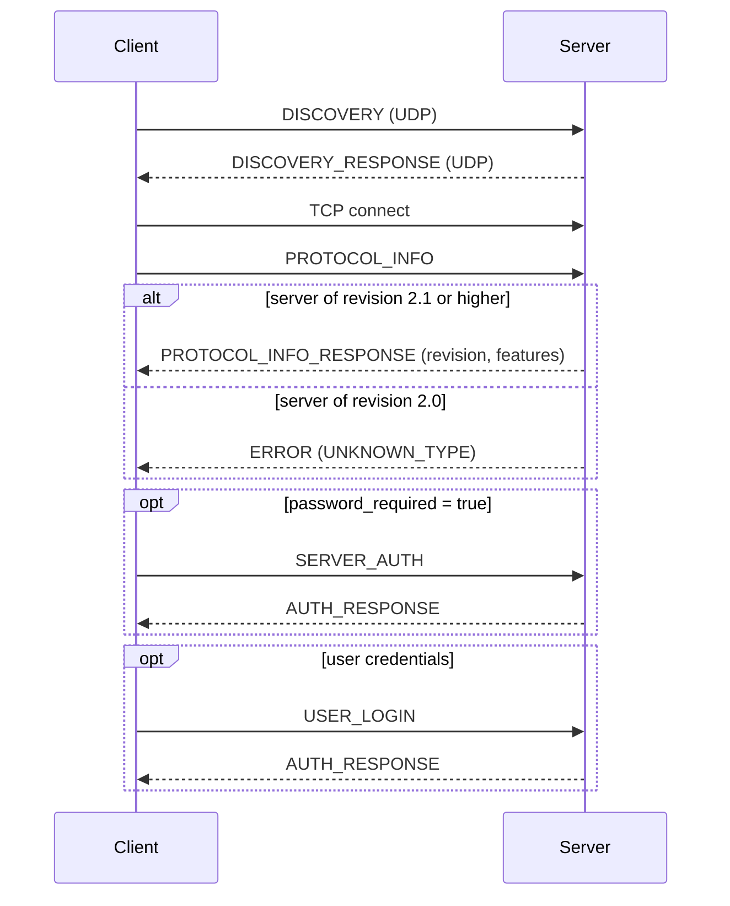
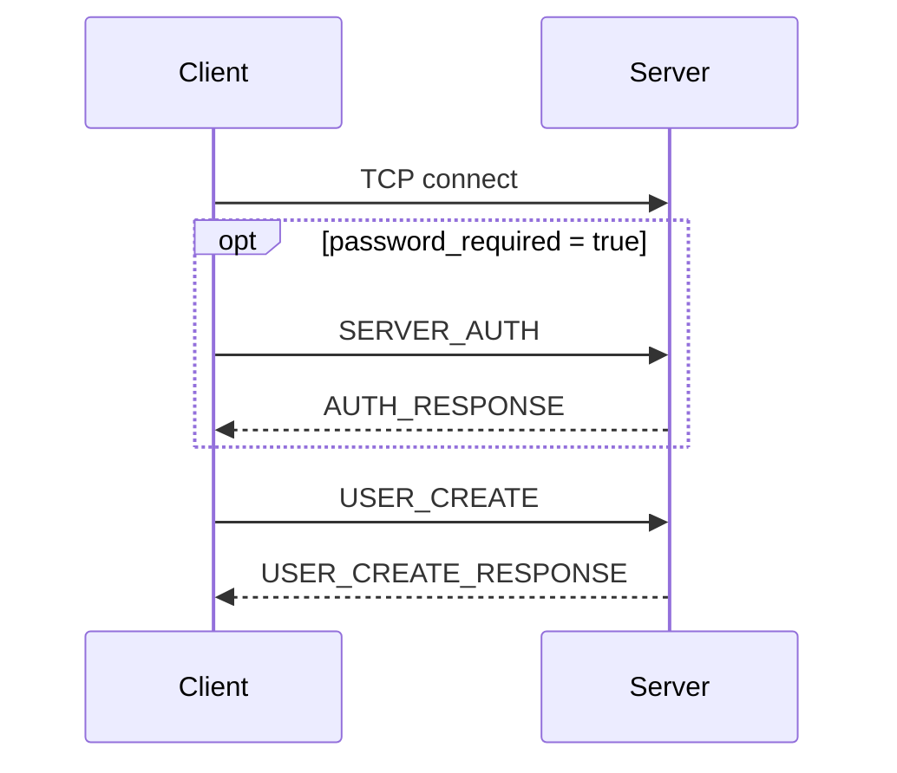
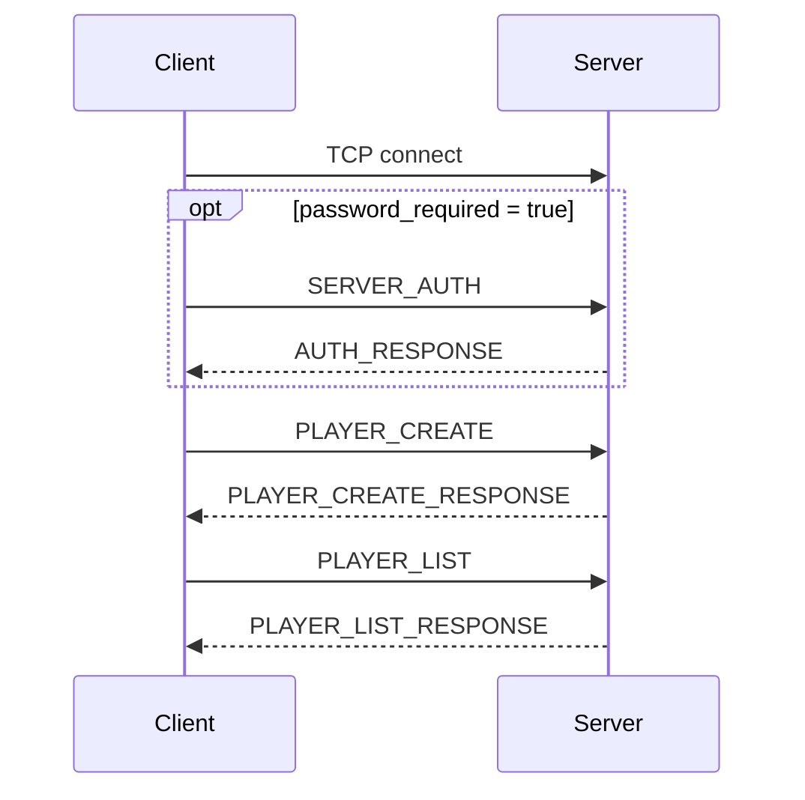
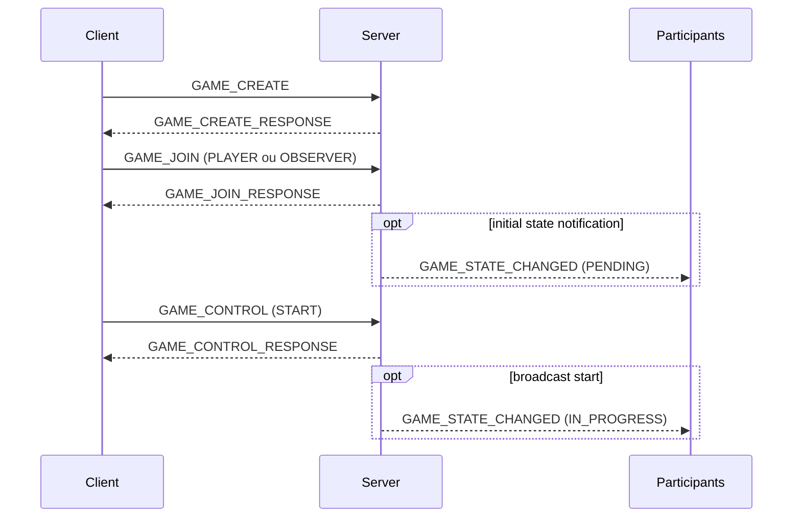
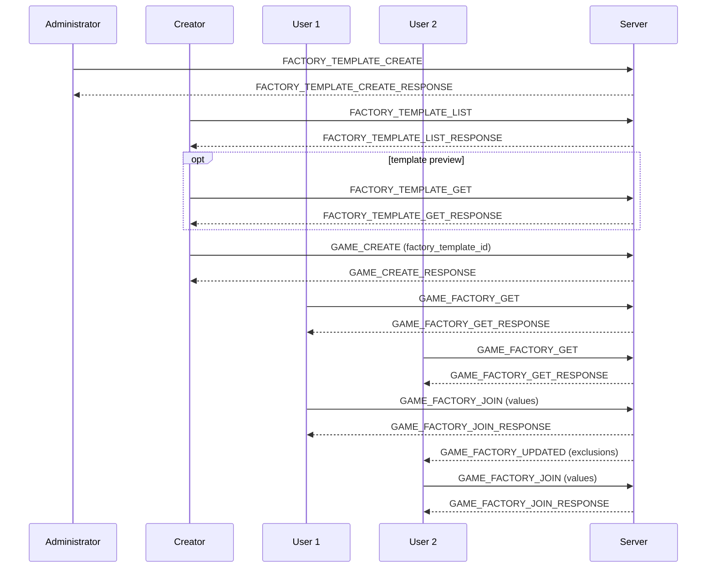
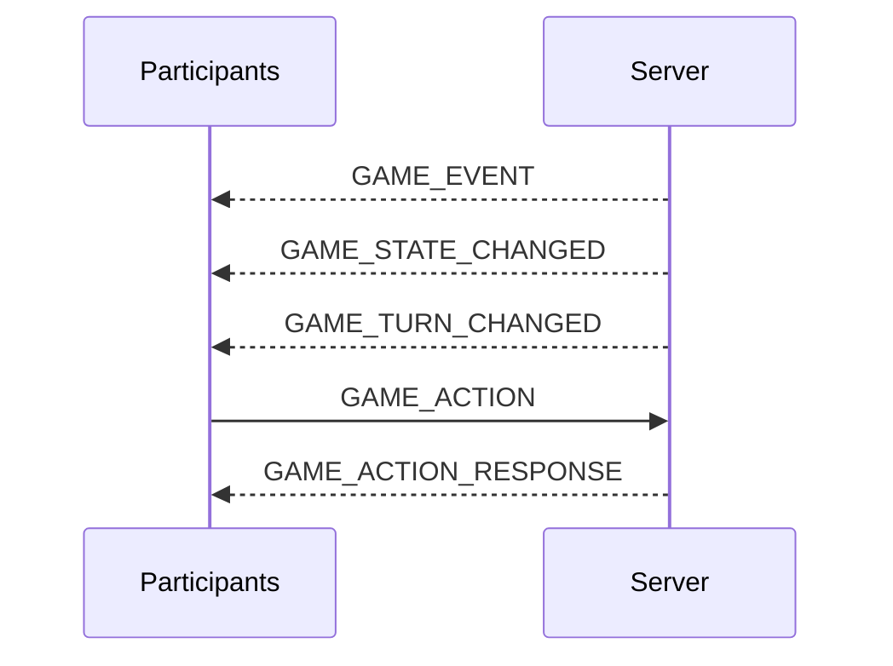
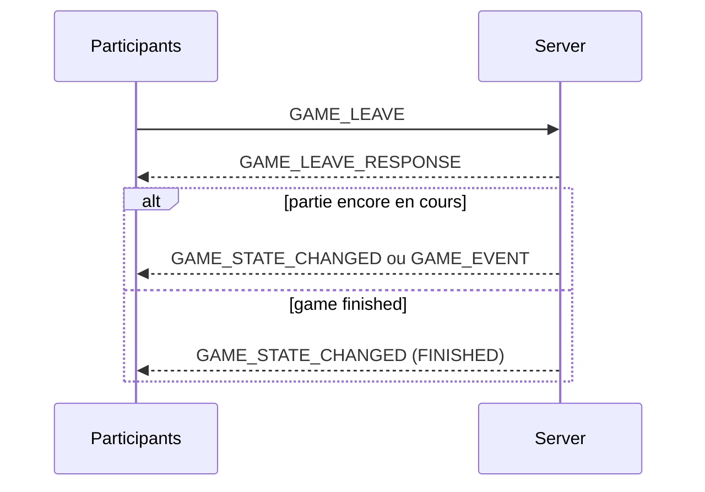
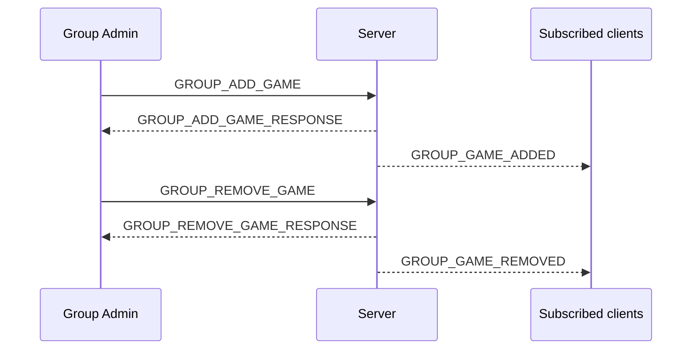
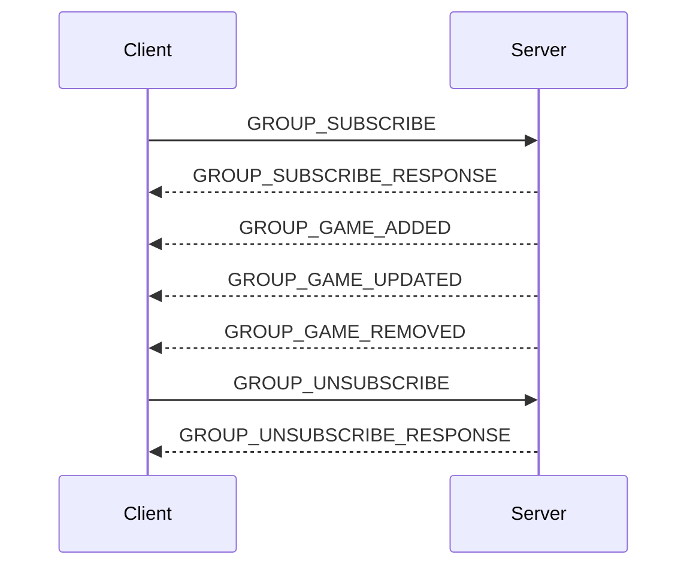

# Exchange protocol between the client and the server

**Protocol version:** 2 — **Revision:** 2.1 (see the "Version history" paragraph)

This section describes the messages exchanged between clients and the server.

## Preamble to the exchange protocol

This section describes the protocol used for message exchanges between clients and the multiplayer server. It specifies the roles of the different actors, the network transports used, the general structure of messages, the validation principles, as well as the access levels applied to clients by the server.

The objective of this protocol is to provide a clear, extensible and predictable exchange framework for the following operations:

- automatic discovery of servers available on the local network;
- establishment of communication between a client and a server;
- authentication and progressive increase of access rights;
- management of users, groups and parties;
- transmission of game events;
- notification of changes in status to the customers concerned;
- server administration.

### Definitions

The following terms are used throughout this section.

#### User

A **user** (or user account) is a persistent entity on the server, defined by a unique identifier, a username and a password. The user allows, after authentication, access to the server with a certain level of rights (PLAYER, GROUP_ADMIN, ADMIN).

A user does not own a **Player** object of their own. Instead, for each user, the server keeps the list of identifiers of their active players (`players_id`), i.e. the **Player** objects created during a session in which the user was authenticated and associated with an unfinished game (or with no game, if they are waiting to be assigned to one). These players are automatically attached to the session upon authentication.

#### Player

A **player** is the entity that actually participates in or observes a game. While the user manages access and permissions, the player carries game-related attributes (name, score, game status, etc.). 

A client can have several **Player** objects during the same session (for example to allow several participants to play on the same computer). However, only one player is considered the **active default player** of the session at any given time.

A **Player** object can only take part in a single game, either as a player or as an observer. A user can nevertheless take part in several games simultaneously, as a player as well as an observer: each participation requires the creation of a distinct **Player** object, each one attached to the user account through the `players_id` list.

In this version of the protocol, a client must have a **Player** object in its session to join a game:
- A player is explicitly created via a dedicated request (`PLAYER_CREATE`), whether the client is authenticated or not. The last player created with the "default" option becomes the reference player for subsequent actions.
- If the client is authenticated, the identifier of the created player is automatically added to the user's `players_id` list.
- Upon authentication, the user's active players (`players_id` list) are attached to the session.

Reference player resolution rule:
- if a request accepts a `player_id` but no identifier is provided, the server uses the active default player of the session;
- if no active default player is available, the request fails with `PLAYER_NOT_FOUND`;
- user authentication attaches the user's active players without removing the other players of the session and without changing the active default player; if the session does not have an active default player yet, the first attached player becomes it;
- user logout detaches from the session the players listed in the user's `players_id` list (they remain in this list and will be attached again at the next authentication); if the active default player was one of them, the session remains without an active default player until a new player is created or explicitly designated.

#### Customer

A **client** is an application that connects to a multiplayer server in order to consult the available information, join or observe a game, play, administer a group of games or administer the server.

A client can represent different types of users depending on its current access level: unauthenticated visitor, logged in user, player, group administrator or server administrator.

From a protocol perspective, a client is identified by its active network connection and the access level that the server has assigned to it. This level of access may change during the session.

#### Server

The **server** is the application that receives messages from clients, validates their content, controls access rights, executes the requested actions and returns the appropriate responses.

He is responsible in particular for:

- listening for incoming connections;
- responding to network discovery requests;
- syntactic and semantic validation of messages received;
- customer authentication;
- the allocation and temporary retention of access levels;
- management of multiplayer objects: users, groups and games;
- sending responses to requests;
- the possible sending of spontaneous notifications to connected clients.

#### Protocol

The **protocol** designates the set of rules that define the way in which clients and the server exchange messages.

It specifies in particular:

- the network transport used;
- the accepted serialization formats;
- the common structure of messages;
- the types of messages available;
- mandatory and optional fields;
- validation rules;
- the access levels necessary to use each request;
- the expected behavior of the server in the event of success or error.

#### Transportation

**Transport** refers to the network mechanism used to transmit a message between a client and the server.

Two transports are used:

- **UDP**, only for network discovery exchanges;
- **TCP**, for main communications between clients and server.

UDP is used for discovery short messages because it allows multicast sending over the local network. UDP messages are autonomous: each datagram corresponds to a complete message.

TCP is used for game and control exchanges because it provides a reliable, orderly connection suitable for ongoing exchanges between a client and the server. Because TCP transports a stream of bytes and not separate messages, each TCP message is preceded by a header indicating the length of the transmitted content.

#### Message

A **message** is a logical unit of information exchanged between a client and the server.

Each message has a type which indicates its nature or the requested action. Depending on the transport and the type of exchange, a message can be:

- a request sent by a client;
- a response sent by the server following a request;
- a notification sent spontaneously by the server;
- a discovery message sent in UDP;
- a discovery response sent in UDP.

Messages are serialized either as UTF-8 encoded JSON or as [MessagePack](https://msgpack.org/index.html). The MessagePack format is preferred for game messages and required for game notifications for performance reasons.

When a message is serialized in MessagePack, it maintains exactly the same logical schema as its JSON version: same field names, same nesting levels and same semantic constraints. The difference only concerns the binary encoding of the data during transmission.

#### Query

A **request** is a message sent by a client to the server to request an action or information.

Example queries:

- search for available servers;
- authenticate with the server;
- create or list the players of the session;
- create a game;
- join or observe a game;
- transmit a game action;
- request the list of available parts;
- modify a configuration;
- administer a user, a group or the server.

Each request is associated with a minimum access level. The server must verify that the client has the required level before executing the requested action.

#### Reply

A **response** is a message sent by the server to a client in reaction to a request.

A response indicates whether the request succeeded or failed. It may contain:

- data requested by the customer;
- a confirmation of execution;
- an error message;
- an error code;
- additional information allowing the customer to understand or correct the request.

Unless otherwise specified, any valid TCP request must produce an explicit response from the server.

#### Notification

A **notification** is a message sent by the server to one or more clients without immediate request from them.

It is used to inform clients of a relevant event or state change, for example:

- a player has joined or left a game;
- a game has started, been paused, resumed or ended;
- the state of a part has changed;
- an administrator modified a configuration;
- the server will shut down;
- a gaming event must be broadcast to participants.

A notification does not necessarily require a response from the customer unless the notification type explicitly states so.

#### Customer session

A **client session** is the period of time a client is connected to the server.
During this session, the server maintains the information necessary for tracking the client, including:

- its current level of access;
- its possible authenticated user;
- the list of **Player** objects created or recovered during the session;
- the **Default Player** object (used automatically if no identifier is specified);
- the parties he joined;
- the groups to which he is subscribed;
- the groups or resources to which he has access;
- the specific rights linked to his role.

This information is temporary and is reset when the client logs out.

### General principles of exchanges

Exchanges follow the following principles.

#### Separation between discovery and main communication

Network discovery uses UDP to allow a client to automatically search for available servers on the local network.

Once a server is discovered, the main exchanges are done in TCP. The client then uses the information provided in the discovery response to establish a connection with the server.

#### Communication primarily initiated by the customer

Most exchanges are initiated by the client in the form of requests. The server validates the request, checks the client's rights, executes the action if it is authorized, then returns a response.

The general scheme is therefore:
```plain text
Client → Server: request
Server → Client: response
```
#### Server-initiated notifications

The server can also send messages without immediate request from the client when an event needs to be brought to its attention.

The diagram is then:
```plain text
Serveur → Client : notification
```
These notifications help keep clients in sync with the state of the server and the games they are participating in or observing.

#### Systematic validation of messages

Any message received must be validated before processing.

The validation concerns in particular:

- the format of the message;
- the presence of mandatory fields;
- the type of values received;
- the authorized values;
- the protocol version;
- consistency of content;
- the customer's access level;
- the existence of the referenced resources;
- the current state of the objects concerned.

An invalid message should not cause the server to stop. It must give rise to an error response when transport and context allow it.

#### Robustness and compatibility

Unknown fields can be ignored when doing so does not compromise security or consistency of processing. This rule facilitates the evolution of the protocol.

On the other hand, the absence of a required field, a value of incorrect type or an explicitly prohibited value renders the message invalid.

Each message contains version information making it possible to distinguish future developments of the protocol.

### Transports and serialization formats

The protocol uses two network transports and two main serialization formats.

#### UDP Messages

UDP messages are used only for network discovery.

They are serialized into UTF-8 encoded JSON. Each UDP datagram contains exactly one complete logical message.

UDP messages are not preceded by a length header, because UDP naturally preserves datagram boundaries.

UDP message families:

- discovery request;
- discovery response.

#### TCP Messages

TCP messages are used for all primary communications between clients and the server.

They can be serialized in two formats:

- JSON encoded in UTF-8, for control, configuration, administration and management messages;
- MessagePack, for game data or game states when binary format is preferred.

Each TCP message is preceded by a 4-byte header indicating the size of the content in bytes, encoded in **big-endian**.
```plain text
[4-byte header (content size)][JSON or MessagePack content]
```
This header is necessary because TCP carries a continuous stream of bytes and does not maintain boundaries between application messages.

The specified length is the size in bytes of the content after serialization, whether JSON or MessagePack.

### General message structure

Unless otherwise indicated, application messages use a common structure.

For JSON messages:
```json
{
  "type": "EVENT_TYPE",
  "version": 2,
  "request_id": "req_12345",
  "payload": {}
}
```
#### Field `type`

The `type` field identifies the nature of the message.

It allows the recipient to determine the treatment to be applied. Its value must belong to the list of types recognized by the protocol.

#### `version` field

The `version` field indicates the major protocol version used for the message.

In this version of the protocol, the expected value is `2`, whatever the protocol revision (see the "Versioning and extensibility" paragraph). A message whose `version` field is not `2` is refused (error code `UNSUPPORTED_VERSION` for a TCP request, message ignored for a discovery request).

#### `payload` field

The `payload` field contains message-specific data.

Its structure depends on the type of message. It can be empty when the message type does not require any additional data.

#### Field `request_id`

The `request_id` field is an optional correlation identifier used for TCP requests and associated responses.

When a client sends it in a TCP request, the server must copy it exactly in the corresponding response. This field allows you to match a response to its original request when multiple requests may be being processed or when notifications may be interspersed in the flow.

If a connection only executes one request at a time, `request_id` can be omitted. It is recommended whenever the client can send multiple requests without waiting for the previous response.

### Customer Access Levels

The server associates a current access level with each connected client. This level determines which queries the client is allowed to use.

Each client starts with the lowest access level. It can then obtain a higher level by successfully completing the authentication or authorization operations provided for by the protocol.

Access levels are hierarchical: a client with a given level can use requests from that level as well as those from lower levels.

The access levels are as follows.

#### `OPEN`

Open access, without authentication.

This level only allows public operations, for example:

- discover a server;
- consult certain public information;
- start an authentication procedure;
- access explicitly exposed information without restriction.

Every client has this level by default.

#### `BASE`

Basic server access.

This level is granted when a client has satisfied the general conditions of access to the server, for example the presentation of the server password if this is required.

If no server password is configured, this level can be considered equivalent to the `OPEN` level.

#### `PLAYER`

Access reserved for authenticated players.

This level allows the client to act as an identified player. It can in particular make it possible to:

- join a game as a player;
- leave a game;
- perform game actions;
- access information related to its own parties;
- receive notifications associated with its games.

#### `GROUP_ADMIN`

Access reserved for group administrators.

This level allows you to perform administration operations limited to groups for which the client has the necessary rights.

It can in particular make it possible to:

- create, modify or delete parts in an administered group;
- manage certain group settings;
- consult administration information limited to the authorized perimeter.

This level does not imply full access to server administration.

#### `ADMIN`

Server administrator access.

This level provides access to global server administration operations.

It can in particular make it possible to:

- manage users;
- manage all groups and all parties;
- modify the server configuration;
- trigger a persistent save or reload;
- consult global status information;
- properly shut down the server.

### Assigning and maintaining access levels

The access level is assigned by the server to each connected client.

At the start of a session, the client is at the `OPEN` level. Its level can then evolve following successful requests, for example:

- validation of the server password;
- authentication of a user;
- verification of a user’s role;
- validation of administrative rights on a group;
- authentication as server administrator.

The current access level is retained until one of the following events:

- disconnection of the client;
- expiration or invalidation of the session;
- explicit request for disconnection or change of identity;
- revocation of rights;
- server shutdown.

Server persistence does not remember the current access level of clients. When a client reconnects, it starts a new session at the `OPEN` level. When persistence is enabled, server configuration changes made through `SERVER_CONFIG_SET` are also saved and restored, including the server name, access policies, visibility, and server password hash.

The participation of a player in a game depends on the kind of player. A guest player, created by `PLAYER_CREATE`, only exists for its session: it leaves its games when the connection closes. The player of a user account stays in its games when the connection closes, even after a `USER_LOGOUT`: the user finds them again by authenticating from any later session, and that session then receives the notifications of these games. It leaves a game through `GAME_LEAVE`, when it is kicked, or when its account is deleted. When persistence is enabled, the players and the observers of the games are saved with their role and restored at startup, as well as the user account which created each game, which therefore keeps the right to control it. Only the players of user accounts are restored, the guest players being bound to sessions that no longer exist.

### Query access control

Each request defines a minimum access level.

Before executing a query, the server must check:

1. that the message is syntactically valid;
2. that the type of request is recognized;
3. that the client's level of access is sufficient;
4. that the requested resources exist;
5. that the current state of the server or game allows the requested action;
6. that the rights specific to the area concerned are respected.

If the access level is insufficient, the server must refuse the request and return an appropriate error.

A high level of access does not necessarily exempt perimeter checks. For example, a group administrator can have the `GROUP_ADMIN` level without being authorized to administer all groups.

### Message families

Protocol messages are grouped into functional families.

This classification makes the specification easier to read and the future evolution of the protocol.

#### Discovery Messages

These messages allow a client to search for available servers on the local network.

Transport used: UDP.

Possible format: JSON

Examples:

- discovery request;
- discovery response.

#### Connection and access messages

These messages make it possible to establish access to the server and to change the client's access level.

Transport used: TCP.

Possible format: JSON

Examples:

- information about the protocol version, revision and features supported by the server;
- presentation of the server password;
- user authentication;
- disconnection;
- session change or reset.

#### User management messages

These messages concern user accounts.

Transport used: TCP.

Possible format: JSON

Examples:

- creation of a user;
- authentication of a user;
- modification of a password;
- consultation or modification of a user profile;
- deletion or deactivation of a user.

#### Game management messages

These messages concern the creation, consultation and modification of parts.

Transport used: TCP.

Possible format: JSON

Examples:

- create a game;
- list the available parts;
- list the players and observers of a game;
- join a game as a player;
- join a game as an observer;
- leave a game;
- start, pause, resume or end a game;
- change the order of players in a turn-based game;
- consult the player factory of a game, to build the player creation form;
- create a player from the player factory of a game and make it join the game.

#### Factory template management messages

These messages concern the player factory templates (`PlayerFactoryTemplate`) held by the server, which define the customization options of the players of a game.

Transport used: TCP.

Possible format: JSON

Examples:

- list the available templates;
- consult a template;
- create, update or delete a template (server administrator).

#### Group management messages

These messages concern party groups.

Transport used: TCP.

Possible format: JSON

Examples:

- create a group;
- subscribe or unsubscribe to a group;
- add a game to a group;
- remove part of a group;
- consult the parties of a group;
- modify the settings of a group.

#### Game Messages

These messages carry game actions, game events, and game states.

Transport used: TCP.

Possible format: JSON

Examples:

- action performed by a player;
- validation or refusal of an action;
- change of turn;
- update of a game state;
- synchronization of a complete or partial state.

#### Notification messages

These messages are sent by the server to notify clients of an event.

Transport used: TCP.

Format used: JSON or MessagePack (required for game notifications).

Examples:

- player joins or leaves a game;
- change of state of a part;
- addition, removal or update of a part in a group;
- game event broadcast to participants;
- warning before server shutdown.

#### Administrative messages

These messages are reserved for clients with elevated rights.

Transport used: TCP.

Possible format: JSON

Examples:

- consult the overall status of the server;
- consult the current server configuration;
- save or reload persistent data;
- modify the configuration;
- consult the audit logs;
- manage users;
- stop the server.

#### Error messages

These messages indicate that a request could not be processed.

Transport used: mainly TCP.

Possible format: JSON

An error may in particular result from:

- invalid message;
- unknown message type;
- incompatible protocol version;
- insufficient level of access;
- non-existent resource;
- incorrect password;
- action prohibited in the current state;
- Internal Server Error.

### General response rules

Unless otherwise specified, any TCP request must produce a response.

A response must allow the client to clearly determine:

- if the request was successful;
- what data is returned;
- what error occurred, if any;
- if the client can correct the request and resend it;
- if its access level has been modified.

If the TCP request contains a `request_id`, the associated response must take exactly this value in order to allow the correlation between request, response and interspersed notifications.

Notifications sent spontaneously by the server do not require a response, unless explicitly mentioned in the description of the message concerned.

UDP discovery messages follow specific logic: an invalid discovery request can simply be ignored by the server, to avoid responding to non-compliant or unsolicited messages.

### Error handling principles

When a request cannot be processed, the server must return a structured error when the transport allows it.

An error should contain at least:

- an error type or code;
- an explanatory message;
- possibly details useful for diagnosis;
- possibly the identifier of the request concerned if the protocol provides for a correlation.

The server should not expose sensitive information in error messages. For example, an authentication error should not unnecessarily distinguish a non-existent user from an incorrect password if this weakens security.

### Versioning and extensibility

The protocol version is indicated in the messages to facilitate future developments.

The following principles apply:

- unknown fields can be ignored when they do not compromise the processing;
- mandatory fields must always be present;
- unknown values for the message type make the message invalid;
- an incompatible version may result in the message being refused;
- new message types may be added in future versions;
- new optional fields can be added without breaking compatibility.

The protocol distinguishes two notions:

- **The major version**, transmitted in the `version` field of each message (currently `2`). It expresses the ability of two programs to communicate, and only changes in the event of a compatibility break.
- **The revision**, of the form `major.minor` (currently `2.1`). It expresses the available features. It is not transmitted in each message, but announced by the server, in the discovery response (`revision` field of `DISCOVERY_RESPONSE`) and in the response to the `PROTOCOL_INFO` request.

A minor revision can only add new message types, new optional fields or new error codes. It never modifies the behavior of existing messages for a client that does not use these additions. A client can thus communicate with a server of a lower or higher revision than its own, for all the features they have in common. Before using a feature introduced by a given revision, a client must check that the server announces a sufficient revision. A server that does not recognize a message type responds with the `UNKNOWN_TYPE` error code.

Each message introduced by a minor revision is flagged in its description by the **Minimum revision** mention.

#### Version history

| Revision | Content |
|---|---|
| 2.0 | Initial revision of version 2 of the protocol. |
| 2.1 | Player factories: factory template management messages (`FACTORY_TEMPLATE_LIST`, `FACTORY_TEMPLATE_GET`, `FACTORY_TEMPLATE_CREATE`, `FACTORY_TEMPLATE_UPDATE`, `FACTORY_TEMPLATE_DELETE`), consultation of the player factory of a game and creation of a player from it (`GAME_FACTORY_GET`, `GAME_FACTORY_JOIN`), `GAME_FACTORY_UPDATED` notification, `factory_template_id` field of `GAME_CREATE`, `has_player_factory` field of `GAME_LIST_RESPONSE`, checks of the factory options and `details` field of `GAME_JOIN_RESPONSE`, `static_attributes` and `dynamic_attributes` fields of `PLAYER_CREATE`, and associated error codes (`FACTORY_TEMPLATE_NOT_FOUND`, `INVALID_OPTION`, `INVALID_OPTION_VALUE`, `LACKING_OPTION`, `NO_PLAYER_FACTORY`, `OPTION_ALREADY_EXISTS`, `OPTION_VALUE_ALREADY_GIVEN`). Revision announcement: `PROTOCOL_INFO` request and `revision` field of `DISCOVERY_RESPONSE`. |

Compatibility between revisions 2.0 and 2.1: a revision 2.0 client keeps working with a revision 2.1 server. However, it can only join as a player a game that has a player factory (`GAME_JOIN`) if its player carries the values expected by the factory; otherwise, it receives one of the error codes `LACKING_OPTION`, `INVALID_OPTION_VALUE` or `OPTION_VALUE_ALREADY_GIVEN`, which it handles like any other error. A revision 2.1 client connected to a revision 2.0 server must not use the messages introduced by revision 2.1: the server would respond `UNKNOWN_TYPE`, and would ignore the new optional fields.

### General security

The protocol must be interpreted according to a principle of distrust of the data received.

The server must consider any client message as potentially invalid, incomplete, malicious, or unauthorized.

In particular, the server must:

- validate all fields received;
- systematically control access levels;
- never trust an identifier provided without verification;
- avoid disclosing sensitive information;
- limit the effects of invalid messages;
- refuse actions inconsistent with the current state;
- apply configured encryption mechanisms when TLS is enabled.


## Discovery messages

### Discovery request

**Direction:** Client → Server  
**Transport:** Multicast UDP  
**Encoding:** JSON UTF-8

**Access level:** OPEN

Message sent by a client to discover available servers on the local network.

#### Example
```json
{
  "type": "DISCOVERY",
  "service_name": "multiplayer_server",
  "version": 2
}
```
#### Fields

| Field | JSON type | Mandatory | Allowed values | Description |
|---|---|---:|---|---|
| `type` | `string` | Yes | `"DISCOVERY"` | Identifies the message as a discovery request. |
| `service_name` | `string` | Yes | `"multiplayer_server"` | Identifies the service sought. |
| `version` | `number` | Yes | `2` | Protocol version. |

#### Validation rules

- Unknown fields should be ignored.
- The absence of a mandatory field renders the message invalid.
- An invalid value for `type`, `service_name` or `version` makes the message invalid.

---

### Discovery Response

**Direction:** Server → Client  
**Transport:** Unicast UDP  
**Encoding:** JSON UTF-8

Message sent by a server in response to a valid discovery request.

#### Example
```json
{
  "type": "DISCOVERY_RESPONSE",
  "service_name": "multiplayer_server",
  "version": 2,
  "revision": "2.1",
  "service_host": "192.168.1.20",
  "service_port": 65432,
  "unencrypted_port": null,
  "name": "Local game server",
  "use_tls": true,
  "password_required": false
}
```
#### Fields

| Field | JSON type | Mandatory | Constraints / allowed values | Description |
|---|---|---:|---|---|
| `type` | `string` | Yes | `"DISCOVERY_RESPONSE"` | Identifies the message as a discovery response. |
| `service_name` | `string` | Yes | `"multiplayer_server"` | Identifies the service. |
| `version` | `number` | Yes | `2` | Major protocol version. |
| `revision` | `string` | No | String of the form `major.minor` (e.g. `"2.1"`) | Protocol revision supported by the server (minimum revision: 2.1). A revision 2.0 server does not send this field: its absence means revision `"2.0"`. |
| `service_host` | `string` | Yes | IPv4 address or DNS name | Address that clients should use to connect to the server. |
| `service_port` | `number` | Yes | Integer from `1` to `65535` | TCP port used by the service's primary or secure access point. |
| `unencrypted_port` | `number\| null` | Yes | Integer from `1` to `65535`, or `null` | TCP port for unencrypted connections. `null` means it is not available. |
| `name` | `string` | Yes | Any string | Readable server name. |
| `use_tls` | `boolean` | Yes | `true` or `false` | Indicates whether TLS is enabled on the service's primary port. |
| `password_required` | `boolean` | Yes | `true` or `false` | Indicates whether a password is required to log in. |

#### Validation rules

- `service_port` must not be `0`.
- `unencrypted_port` must be either `null` or an integer between `1` and `65535`.
- `service_host` must be reachable by the client.
- If `use_tls` is `true`, `service_port` is the server's primary TLS access point. If `unencrypted_port` is not `null`, it designates an optional unencrypted TCP port.
- If `use_tls` is `false`, `service_port` is the server's primary unencrypted TCP port and `unencrypted_port` must be `null`.
- When `unencrypted_port` is not `null`, clients that do not want or cannot use TLS should use `unencrypted_port` rather than `service_port`.
- If `password_required` is `true`, the client must authenticate using the intended connection protocol.
- If `revision` is absent, the client must consider that the server is of revision `"2.0"`.

---

## Connection and access messages

These messages allow the client to establish a session with the server and change its access level.

### Protocol information

**Direction:** Client → Server  
**Transport:** TCP  
**Encoding:** JSON UTF-8  
**Minimum access level:** `OPEN`  
**Minimum revision:** 2.1

Allows a client to know the protocol version and revision supported by the server, as well as the available features, in order to only use the messages that the server is able to process. It is recommended to send it immediately after establishing the TCP connection. This request can be used before any authentication, including when the server requires a password (`password_required` set to `true`).

A revision 2.0 server does not know this request and responds with the `UNKNOWN_TYPE` error code: the client must then consider that the server is of revision `"2.0"`, without any optional feature.

#### Example
```json
{
  "type": "PROTOCOL_INFO",
  "version": 2,
  "payload": {}
}
```
#### Response (`PROTOCOL_INFO_RESPONSE`)
```json
{
  "type": "PROTOCOL_INFO_RESPONSE",
  "version": 2,
  "payload": {
    "success": true,
    "version": 2,
    "revision": "2.1",
    "features": ["player_factory"],
    "message": "Protocol information retrieved successfully"
  }
}
```
#### Fields (`PROTOCOL_INFO`)

| Field | JSON type | Mandatory | Description |
|---|---|---:|---|
| `type` | `string` | Yes | `"PROTOCOL_INFO"` |
| `version` | `number` | Yes | `2` |
| `payload` | `object` | Yes | Empty object. |

#### Fields (`PROTOCOL_INFO_RESPONSE`)

| Field | JSON type | Mandatory | Description |
|---|---|---:|---|
| `payload.success` | `boolean` | Yes | `true` if the request was successful. |
| `payload.version` | `number` | Yes | Major protocol version (`2`). |
| `payload.revision` | `string` | Yes | Protocol revision supported by the server, of the form `major.minor` (e.g. `"2.1"`). |
| `payload.features` | `array` | Yes | List of the optional features available on the server (see below). Can be empty. |
| `payload.message` | `string` | Yes | Information message. |

#### Features

A feature groups a set of messages and fields. Its presence in the `features` list indicates that the server is able to process them. A feature is introduced by a given revision, but a server of sufficient revision may not offer it (for example if it is disabled by its configuration): the client must therefore rely on the `features` list rather than on the revision number alone.

| Feature | Minimum revision | Messages and fields concerned |
|---|---|---|
| `player_factory` | 2.1 | Factory template management messages (`FACTORY_TEMPLATE_*`), `GAME_FACTORY_GET` and `GAME_FACTORY_JOIN` requests, `GAME_FACTORY_UPDATED` notification, `factory_template_id` field of `GAME_CREATE`, `has_player_factory` field of `GAME_LIST_RESPONSE`. |

---

### Server password overview

**Direction:** Client → Server  
**Transport:** TCP  
**Encoding:** JSON UTF-8  
**Minimum access level:** `OPEN`

This request is used when a server requires a password to authorize basic access (moving to the `BASE` level). It must be sent immediately after establishing the TCP connection if `password_required` was `true` in the discovery response.

When `password_required` is `true`, no other application request should be sent before `SERVER_AUTH` succeeds, except for the `PROTOCOL_INFO` request, which remains usable at the `OPEN` level. After successful server authentication, the client moves to the `BASE` level and can then send requests authorized by this level.

If `password_required` is `false`, the client can directly send requests authorized at the `OPEN` or `BASE` level depending on the context of the server and the configured password.

#### Example
```json
{
  "type": "SERVER_AUTH",
  "version": 2,
  "payload": {
    "password": "server_password_123"
  }
}
```
#### Fields

| Field | JSON type | Mandatory | Description |
|---|---|---:|---|
| `type` | `string` | Yes | `"SERVER_AUTH"` |
| `version` | `number` | Yes | `2` |
| `payload.password` | `string` | Yes | The server password in clear text. |

---

### Creation of a player

**Direction:** Client → Server  
**Transport:** TCP  
**Encoding:** JSON UTF-8  
**Minimum access level:** `BASE`

This request allows a connected client (`BASE` level or higher) to create a **Player** object. This is essential to be able to join or observe a game. An unauthenticated client can thus take part as a simple visitor, the player then being created for the duration of its session. If the client is authenticated, the identifier of the created player is automatically added to the user's `players_id` list, so that it can be retrieved at a later authentication as long as it remains active.

A client can create several players during the session (for example to manage several participants on the same machine). One of them can be designated as the "default" player for the session. If a default player already exists, the new player created with the `is_default` option set to `true` takes that role, but the previous player continues to exist.

The custom attributes of the player are provided by the client, which chooses in which dictionary of the **Player** object each of them is stored: `static_attributes` for attributes that do not change, or rarely, during the game (`static_state` dictionary), `dynamic_attributes` for those that can change often (`dynamic_state` dictionary). This choice is important when the player is intended to join a game that has a player factory: the checks performed when the player arrives look for the value of each option in the dictionary associated with the option (see `GAME_FACTORY_GET`, `target` field). To create a player compliant with the player factory of a game, it is simpler to use the `GAME_FACTORY_JOIN` request.

The `attributes` field is kept for compatibility: it is equivalent to `dynamic_attributes`.

#### Example
```json
{
  "type": "PLAYER_CREATE",
  "version": 2,
  "payload": {
    "name": "GuestPlayer",
    "is_default": true,
    "static_attributes": {
      "color": "blue"
    },
    "dynamic_attributes": {
      "score": 0
    }
  }
}
```
#### Response (`PLAYER_CREATE_RESPONSE`)
```json
{
  "type": "PLAYER_CREATE_RESPONSE",
  "version": 2,
  "payload": {
    "success": true,
    "player_id": "uuid_du_joueur_cree",
    "message": "Player created successfully"
  }
}
```
#### Fields (`PLAYER_CREATE`)

| Field | JSON type | Mandatory | Description |
|---|---|---:|---|
| `type` | `string` | Yes | `"PLAYER_CREATE"` |
| `version` | `number` | Yes | `2` |
| `payload.name` | `string` | Yes | Desired name for the player. |
| `payload.is_default` | `boolean` | No | If `true`, this player becomes the default player of the session (`true` by default if it is the first player). |
| `payload.static_attributes` | `object` | No | Custom attributes stored in the `static_state` dictionary of the player. Minimum revision: 2.1. |
| `payload.dynamic_attributes` | `object` | No | Custom attributes stored in the `dynamic_state` dictionary of the player. Minimum revision: 2.1. |
| `payload.attributes` | `object` | No | Kept for compatibility, equivalent to `dynamic_attributes`. A same key cannot appear in both `attributes` and `dynamic_attributes` (`INVALID_DATA` error). |

#### Fields (`PLAYER_CREATE_RESPONSE`)

| Field | JSON type | Mandatory | Description |
|---|---|---:|---|
| `payload.success` | `boolean` | Yes | `true` if the creation was successful. |
| `payload.player_id` | `string` | No | UUID of the created player (if successful). |
| `payload.error_code` | `string` | No | Error code on failure. |
| `payload.message` | `string` | Yes | Information or error message. |

#### Error codes (`PLAYER_CREATE_RESPONSE`)

| Code | Description |
|---|---|
| `INVALID_NAME` | The name provided is invalid or already in use. |
| `INVALID_DATA` | The attributes provided are malformed (they are not JSON objects), or a same key appears in both `attributes` and `dynamic_attributes`. |

---

### List of players of the session

**Direction:** Client → Server  
**Transport:** TCP  
**Encoding:** JSON UTF-8  
**Minimum access level:** `BASE`

This query allows the client to retrieve the list of all **Player** objects associated with its current session. This includes players created via the `PLAYER_CREATE` request as well as, if the client is authenticated, the user's active players attached to the session upon authentication.

The response specifies for each player their unique identifier, their name and whether they are the default player for the session.

#### Example
```json
{
  "type": "PLAYER_LIST",
  "version": 2,
  "payload": {}
}
```
#### Response (`PLAYER_LIST_RESPONSE`)
```json
{
  "type": "PLAYER_LIST_RESPONSE",
  "version": 2,
  "payload": {
    "success": true,
    "players": [
      {
        "player_id": "uuid_joueur_1",
        "name": "GuestPlayer",
        "is_default": false
      },
      {
        "player_id": "uuid_joueur_2",
        "name": "AuthenticatedUser",
        "is_default": true
      }
    ]
  }
}
```
#### Fields (`PLAYER_LIST`)

| Field | JSON type | Mandatory | Description |
|---|---|---:|---|
| `type` | `string` | Yes | `"PLAYER_LIST"` |
| `version` | `number` | Yes | `2` |

#### Fields (`PLAYER_LIST_RESPONSE`)

| Field | JSON type | Mandatory | Description |
|---|---|---:|---|
| `payload.success` | `boolean` | Yes | `true` if the request was successful. |
| `payload.players` | `array` | No | List of player objects associated with the session (if successful). |
| `payload.players[].player_id` | `string` | - | Player UUID. |
| `payload.players[].name` | `string` | - | Player name. |
| `payload.players[].is_default` | `boolean` | - | `true` if this is the session's default player. |
| `payload.error_code` | `string` | No | Error code on failure. |
| `payload.message` | `string` | No | Information or error message. |

---

### Editing a player in the session

**Direction:** Client → Server  
**Transport:** TCP  
**Encoding:** JSON UTF-8  
**Minimum access level:** `BASE`

This request allows the client to modify the name of a **Player** object associated with its session (player created via `PLAYER_CREATE` or active player of the user attached upon authentication), and/or to empty its custom attributes (`static_state` and `dynamic_state`).

Since a **Player** object can only take part in a single game, a client may reuse a player that left its game to join another game. Resetting its attributes beforehand (`reset_state`) prevents the attributes of the former game from disturbing the new one. The reset is refused while the player takes part in a game (including a finished game).

#### Example
```json
{
  "type": "PLAYER_UPDATE",
  "version": 2,
  "payload": {
    "player_id": "uuid_du_joueur",
    "name": "NouveauNom",
    "reset_state": true
  }
}
```
#### Response (`PLAYER_UPDATE_RESPONSE`)
```json
{
  "type": "PLAYER_UPDATE_RESPONSE",
  "version": 2,
  "payload": {
    "success": true,
    "player_id": "uuid_du_joueur",
    "message": "Player updated successfully"
  }
}
```
#### Fields (`PLAYER_UPDATE`)

| Field | JSON type | Mandatory | Description |
|---|---|---:|---|
| `type` | `string` | Yes | `"PLAYER_UPDATE"` |
| `version` | `number` | Yes | `2` |
| `payload.player_id` | `string` | Yes | UUID of the player to modify. |
| `payload.name` | `string` | No | New name for the player. Mandatory unless `reset_state` is `true`. |
| `payload.reset_state` | `boolean` | No | `true` to empty the custom attributes (`static_state` and `dynamic_state`) of the player. Defaults to `false`. |

#### Fields (`PLAYER_UPDATE_RESPONSE`)

| Field | JSON type | Mandatory | Description |
|---|---|---:|---|
| `payload.success` | `boolean` | Yes | `true` if the modification was successful. |
| `payload.player_id` | `string` | No | Player UUID changed. |
| `payload.error_code` | `string` | No | Error code on failure. |
| `payload.message` | `string` | Yes | Information or error message. |

#### Error codes (`PLAYER_UPDATE_RESPONSE`)

| Code | Description |
|---|---|
| `PLAYER_NOT_FOUND` | The specified player does not exist in this session. |
| `INVALID_NAME` | The new name is invalid or already in use, or no name is provided without `reset_state`. |
| `ALREADY_IN_GAME` | `reset_state` is requested while the player takes part in a game. |
| `INSUFFICIENT_PERMISSIONS` | The client does not have the rights to modify this player. |

---

### User authentication

**Direction:** Client → Server  
**Transport:** TCP  
**Encoding:** JSON UTF-8  
**Minimum access level:** `BASE`

This request allows a client to authenticate with a user account to obtain the `PLAYER`, `GROUP_ADMIN` or `ADMIN` access level depending on the role associated with the account. 

If successful, the user's active **Player** objects (`players_id` list) are attached to the session. Any players previously created during the session are not deleted, and the active default player of the session is kept; if the session does not have one yet, the first attached player becomes it.

#### Example
```json
{
  "type": "USER_LOGIN",
  "version": 2,
  "payload": {
    "username": "player_one",
    "password": "user_password_456"
  }
}
```
#### Fields

| Field | JSON type | Mandatory | Description |
|---|---|---:|---|
| `type` | `string` | Yes | `"USER_LOGIN"` |
| `version` | `number` | Yes | `2` |
| `payload.username` | `string` | Yes | User name. |
| `payload.password` | `string` | Yes | User password. |

---

### Authentication response

**Direction:** Server → Client  
**Transport:** TCP  
**Encoding:** JSON UTF-8

Message sent by the server in response to a `SERVER_AUTH` or `USER_LOGIN` request.

#### Example (Success)
```json
{
  "type": "AUTH_RESPONSE",
  "version": 2,
  "payload": {
    "success": true,
    "access_level": "PLAYER",
    "username": "player_one",
    "role": "PLAYER",
    "players": [
      {
        "player_id": "uuid_of_active_player_1",
        "name": "player_one"
      }
    ],
    "message": "Authentication successful"
  }
}
```
#### Example (Failed)
```json
{
  "type": "AUTH_RESPONSE",
  "version": 2,
  "payload": {
    "success": false,
    "access_level": "OPEN",
    "error_code": "INVALID_CREDENTIALS",
    "message": "Invalid username or password"
  }
}
```
#### Fields

| Field | JSON type | Mandatory | Description |
|---|---|---:|---|
| `type` | `string` | Yes | `"AUTH_RESPONSE"` |
| `version` | `number` | Yes | `2` |
| `payload.success` | `boolean` | Yes | `true` if authentication was successful. |
| `payload.access_level` | `string` | Yes | New level of access granted to the customer. |
| `payload.username` | `string` | No | Name of the authenticated user (if successful `USER_LOGIN`). |
| `payload.role` | `string` | No | User role (if successful `USER_LOGIN`). |
| `payload.players` | `array` | No | List of the user's active players attached to the session (if `USER_LOGIN` is successful; empty list if the user has no active player). |
| `payload.players[].player_id` | `string` | - | Player UUID. |
| `payload.players[].name` | `string` | - | Player name. |
| `payload.error_code` | `string` | No | Error code in case of failure (see table below). |
| `payload.message` | `string` | Yes | Information or error message. |

#### Error codes (`AUTH_RESPONSE`)

| Code | Description |
|---|---|
| `INVALID_PASSWORD` | The server password is incorrect (`SERVER_AUTH`). |
| `INVALID_CREDENTIALS` | The username or password is incorrect (`USER_LOGIN`). |
| `USER_NOT_FOUND` | The specified user does not exist. |
| `ACCOUNT_DISABLED` | The user account has been disabled by an administrator. |
| `ALREADY_AUTHENTICATED` | The client is already authenticated with a user account. |

---

### Disconnect

**Direction:** Client → Server  
**Transport:** TCP  
**Encoding:** JSON UTF-8  
**Minimum access level:** `BASE`

This request allows the client to properly close its authenticated session and return to the `BASE` access level (or `OPEN` if no server password is required), without necessarily closing the TCP connection.

Logging out does not delete any player. The players listed in the user's `players_id` list (including those created during the authenticated session) are detached from the session; they remain in this list and will be attached again at the next authentication as long as they remain active. The other players of the session remain attached. If the active default player was one of the detached players, the session remains without an active default player until a new player is created or explicitly designated.

#### Example
```json
{
  "type": "USER_LOGOUT",
  "version": 2,
  "payload": {}
}
```
#### Fields

| Field | JSON type | Mandatory | Description |
|---|---|---:|---|
| `type` | `string` | Yes | `"USER_LOGOUT"` |
| `version` | `number` | Yes | `2` |
| `payload` | `object` | Yes | Empty object. |

---

## User management messages

These messages concern user accounts.

### Creating a user account

**Direction:** Client → Server  
**Transport:** TCP  
**Encoding:** JSON UTF-8  
**Minimum access level:** `BASE` or `ADMIN`

This request allows you to create a new user account on the server.

Creating a user account does not generate any **Player** object: players are created separately via the `PLAYER_CREATE` request, which also accepts the game-related custom attributes (`static_attributes` and `dynamic_attributes` fields), or via the `GAME_FACTORY_JOIN` request for games that have a player factory. The players created while the user is authenticated are added to the `players_id` list of their account.

#### Creation rules

Creation permission depends on the client's access level:
- **`BASE` level**: Can only create an account with the `PLAYER` role, and only if account creation is explicitly authorized in the server configuration.
- **`ADMIN` level**: Can create accounts with any role (`PLAYER`, `GROUP_ADMIN` or `ADMIN`).

#### Example
```json
{
  "type": "USER_CREATE",
  "version": 2,
  "payload": {
    "username": "new_player",
    "password": "secret_password",
    "email": "player@example.com",
    "role": "PLAYER"
  }
}
```
#### Fields

| Field | JSON type | Mandatory | Description |
|---|---|---:|---|
| `type` | `string` | Yes | `"USER_CREATE"` |
| `version` | `number` | Yes | `2` |
| `payload.username` | `string` | Yes | Name of new user (must be unique). |
| `payload.password` | `string` | Yes | Account password. |
| `payload.email` | `string` | No | User email address. |
| `payload.role` | `string` | No | Desired role (`PLAYER`, `GROUP_ADMIN`, `ADMIN`). Defaults to `"PLAYER"`. Subject to the creation rules above. |

---

### User creation response

**Direction:** Server → Client  
**Transport:** TCP  
**Encoding:** JSON UTF-8

Message sent by the server in response to a `USER_CREATE` request.

#### Example (Success)
```json
{
  "type": "USER_CREATE_RESPONSE",
  "version": 2,
  "payload": {
    "success": true,
    "username": "new_player",
    "message": "User account created successfully"
  }
}
```
#### Example (Failed)
```json
{
  "type": "USER_CREATE_RESPONSE",
  "version": 2,
  "payload": {
    "success": false,
    "error_code": "USER_ALREADY_EXISTS",
    "message": "Username already taken"
  }
}
```
#### Fields

| Field | JSON type | Mandatory | Description |
|---|---|---:|---|
| `type` | `string` | Yes | `"USER_CREATE_RESPONSE"` |
| `version` | `number` | Yes | `2` |
| `payload.success` | `boolean` | Yes | `true` if the creation was successful. |
| `payload.username` | `string` | No | Name of user created (if successful). |
| `payload.error_code` | `string` | No | Error code in case of failure (see table below). |
| `payload.message` | `string` | Yes | Information or error message. |

#### Error codes (`USER_CREATE_RESPONSE`)

| Code | Description |
|---|---|
| `USER_ALREADY_EXISTS` | A user with this name already exists. |
| `INSUFFICIENT_PERMISSIONS` | The customer does not have the necessary rights to create a user with this role. |
| `REGISTRATION_DISABLED` | Account creation for `BASE` level users is disabled. |
| `INVALID_DATA` | The data provided (username, password, role) is invalid or malformed. |

---

### Editing a user account

**Direction:** Client → Server  
**Transport:** TCP  
**Encoding:** JSON UTF-8  
**Minimum access level:** `PLAYER` (for own account) or `ADMIN`

This request allows you to modify the information of an existing user account. Game-related attributes are not part of the account: they are carried by the players (see `PLAYER_CREATE`).

#### Example
```json
{
  "type": "USER_UPDATE",
  "version": 2,
  "payload": {
    "username": "new_player",
    "password": "new_secret_password",
    "email": "new_email@example.com",
    "managed_groups": ["group_uuid_1"]
  }
}
```
#### Fields

| Field | JSON type | Mandatory | Description |
|---|---|---:|---|
| `type` | `string` | Yes | `"USER_UPDATE"` |
| `version` | `number` | Yes | `2` |
| `payload.username` | `string` | Yes | Name of the user to modify. |
| `payload.password` | `string` | No | New Password. |
| `payload.email` | `string` | No | New email address. |
| `payload.role` | `string` | No | New role (requires `ADMIN`). |
| `payload.managed_groups` | `array` | No | List of managed group UUIDs (requires `ADMIN`). |

---

### User edit response

**Direction:** Server → Client  
**Transport:** TCP  
**Encoding:** JSON UTF-8

Message sent by the server in response to a `USER_UPDATE` request.

#### Example (Success)
```json
{
  "type": "USER_UPDATE_RESPONSE",
  "version": 2,
  "payload": {
    "success": true,
    "username": "new_player",
    "message": "User account updated successfully"
  }
}
```
#### Example (Failed)
```json
{
  "type": "USER_UPDATE_RESPONSE",
  "version": 2,
  "payload": {
    "success": false,
    "error_code": "USER_NOT_FOUND",
    "message": "User not found"
  }
}
```
#### Fields

| Field | JSON type | Mandatory | Description |
|---|---|---:|---|
| `type` | `string` | Yes | `"USER_UPDATE_RESPONSE"` |
| `version` | `number` | Yes | `2` |
| `payload.success` | `boolean` | Yes | `true` if the modification was successful. |
| `payload.username` | `string` | No | User name changed (if successful). |
| `payload.error_code` | `string` | No | Error code in case of failure (see table below). |
| `payload.message` | `string` | Yes | Information or error message. |

#### Error codes (`USER_UPDATE_RESPONSE`)

| Code | Description |
|---|---|
| `USER_NOT_FOUND` | The user to modify was not found. |
| `INSUFFICIENT_PERMISSIONS` | The client does not have the rights to modify this user or some of its fields (eg: role). |
| `INVALID_DATA` | The new data is invalid. |

---

### Deleting a user account

**Direction:** Client → Server  
**Transport:** TCP  
**Encoding:** JSON UTF-8  
**Minimum access level:** `ADMIN`

This request allows you to delete (or deactivate) a user account.

#### Example
```json
{
  "type": "USER_DELETE",
  "version": 2,
  "payload": {
    "username": "old_player"
  }
}
```
#### Fields

| Field | JSON type | Mandatory | Description |
|---|---|---:|---|
| `type` | `string` | Yes | `"USER_DELETE"` |
| `version` | `number` | Yes | `2` |
| `payload.username` | `string` | Yes | Name of user to delete. |

---

### User deletion response

**Direction:** Server → Client  
**Transport:** TCP  
**Encoding:** JSON UTF-8

Message sent by the server in response to a `USER_DELETE` request.

#### Example (Success)
```json
{
  "type": "USER_DELETE_RESPONSE",
  "version": 2,
  "payload": {
    "success": true,
    "username": "old_player",
    "message": "User account deleted successfully"
  }
}
```
#### Example (Failed)
```json
{
  "type": "USER_DELETE_RESPONSE",
  "version": 2,
  "payload": {
    "success": false,
    "error_code": "USER_NOT_FOUND",
    "message": "User not found"
  }
}
```
#### Fields

| Field | JSON type | Mandatory | Description |
|---|---|---:|---|
| `type` | `string` | Yes | `"USER_DELETE_RESPONSE"` |
| `version` | `number` | Yes | `2` |
| `payload.success` | `boolean` | Yes | `true` if the deletion was successful. |
| `payload.username` | `string` | No | User name removed (if successful). |
| `payload.error_code` | `string` | No | Error code in case of failure (see table below). |
| `payload.message` | `string` | Yes | Information or error message. |

#### Error codes (`USER_DELETE_RESPONSE`)

| Code | Description |
|---|---|
| `USER_NOT_FOUND` | The user to delete does not exist. |
| `INSUFFICIENT_PERMISSIONS` | Only an administrator can delete an account. |
| `CANNOT_DELETE_SELF` | An administrator cannot delete their own account via this request. |

---

### List of connected users

**Direction:** Client → Server  
**Transport:** TCP  
**Encoding:** JSON UTF-8  
**Minimum access level:** `PLAYER` (if allowed by configuration) or `ADMIN`

This query allows you to obtain the list of users currently connected to the server.

#### Example
```json
{
  "type": "USER_LIST",
  "version": 2,
  "payload": {}
}
```
#### Response (`USER_LIST_RESPONSE`)
```json
{
  "type": "USER_LIST_RESPONSE",
  "version": 2,
  "payload": {
    "success": true,
    "users": [
      { "username": "player_one", "role": "PLAYER" },
      { "username": "admin_user", "role": "ADMIN" }
    ]
  }
}
```
#### Fields (`USER_LIST`)

| Field | JSON type | Mandatory | Description |
|---|---|---:|---|
| `type` | `string` | Yes | `USER_LIST` |
| `version` | `number` | Yes | `2` |
| `payload` | `object` | Yes | Empty object. |

#### Fields (`USER_LIST_RESPONSE`)

| Field | JSON type | Mandatory | Description |
|---|---|---:|---|
| `type` | `string` | Yes | `USER_LIST_RESPONSE` |
| `version` | `number` | Yes | `2` |
| `payload.success` | `boolean` | Yes | `true` if the request was successful. |
| `payload.users` | `array` | No | List of connected user objects (if successful). |
| `payload.users[].username` | `string` | - | User name. |
| `payload.users[].role` | `string` | - | User role. |
| `payload.error_code` | `string` | No | Error code in case of failure (see table below). |
| `payload.message` | `string` | Yes | Information or error message. |

#### Error codes (`USER_LIST_RESPONSE`)

| Code | Description |
|---|---|
| `INSUFFICIENT_PERMISSIONS` | The client access level does not allow users to be listed (query disabled for the `PLAYER` level). |

---

## Game management messages

This section describes messages for creating, listing, and joining game parties.

### Creating a game

**Direction:** Client → Server  
**Transport:** TCP  
**Encoding:** JSON UTF-8  
**Minimum access level:** `BASE`

Allows you to create a new game instance on the server.

The game can be given, from its creation, a player factory built from a template held by the server (`factory_template_id` field, see `FACTORY_TEMPLATE_LIST`). The template can only be chosen when the game is created: the protocol does not provide any request to add, replace or remove the player factory of an existing game. The options of the factory are copies of those of the template: a later update or deletion of the template has no effect on the game.

#### Example
```json
{
  "type": "GAME_CREATE",
  "version": 2,
  "payload": {
    "name": "Ma Super Partie",
    "group_id": "optional_group_uuid",
    "group_password": "group_secret",
    "min_players": 2,
    "max_players": 4,
    "max_observers": 10,
    "turn_based": true,
    "password": "private_game",
    "factory_template_id": "template_uuid",
    "attributes": {
      "map": "island_01",
      "difficulty": "medium"
    }
  }
}
```
#### Response (`GAME_CREATE_RESPONSE`)
```json
{
  "type": "GAME_CREATE_RESPONSE",
  "version": 2,
  "payload": {
    "success": true,
    "game_id": "game_uuid",
    "message": "Game created successfully"
  }
}
```
#### Fields (`GAME_CREATE`)

| Field | JSON type | Mandatory | Description |
|---|---|---:|---|
| `payload.name` | `string` | Yes | Name of the game. |
| `payload.min_players` | `number` | No | Minimum number of players required to start the game (integer). Default `0` (the game can start without any player). If greater than `max_players`, `max_players` is used instead (the game then needs exactly `max_players` players to start). |
| `payload.max_players` | `number` | No | Maximum number of players. Can be `null` (unlimited). |
| `payload.max_observers` | `number` | No | Maximum number of observers. Can be `null` (unlimited). |
| `payload.turn_based` | `boolean` | No | `true` if the game is turn-based. |
| `payload.password` | `string` | No | Password to join the game. |
| `payload.group_id` | `string` | No | Group UUID in which to create the game. |
| `payload.group_password` | `string` | No | Group password, required when the session has not already been authorized. |
| `payload.factory_template_id` | `string` | No | UUID of the player factory template to apply to the game. If absent or `null`, the game has no player factory. Minimum revision: 2.1 (`player_factory` feature). |
| `payload.attributes` | `object` | No | Custom game attributes. |

#### Fields (`GAME_CREATE_RESPONSE`)

| Field | JSON type | Mandatory | Description |
|---|---|---:|---|
| `payload.success` | `boolean` | Yes | `true` if the creation was successful. |
| `payload.game_id` | `string` | No | UUID of the created game (if successful). |
| `payload.error_code` | `string` | No | Error code in case of failure (see table below). |
| `payload.message` | `string` | Yes | Information or error message. |

#### Error codes (`GAME_CREATE_RESPONSE`)

| Code | Description |
|---|---|
| `INSUFFICIENT_PERMISSIONS` | The user role does not allow creating a game. |
| `INVALID_DATA` | Invalid creation parameters. |
| `LIMIT_REACHED` | The maximum number of games on the server has been reached. |
| `FACTORY_TEMPLATE_NOT_FOUND` | The factory template indicated by `factory_template_id` does not exist. The game is not created. |

---

### List of games

**Direction:** Client → Server  
**Transport:** TCP  
**Encoding:** JSON UTF-8  
**Minimum access level:** `BASE`

Retrieves the list of games available on the server. A client at `BASE` level
may retrieve the games of a protected group by providing `group_password`.
The group administrator and server administrator do not need to provide it.

#### Example
```json
{
  "type": "GAME_LIST",
  "version": 2,
  "payload": {
    "group_id": "optional_group_uuid",
    "group_password": "group_secret"
  }
}
```
#### Response (`GAME_LIST_RESPONSE`)
```json
{
  "type": "GAME_LIST_RESPONSE",
  "version": 2,
  "payload": {
    "success": true,
    "games": [
      {
        "game_id": "uuid_1",
        "name": "Game A",
        "state": "PENDING",
        "players_count": 2,
        "min_players": 2,
        "max_players": 4,
        "observers_count": 3,
        "max_observers": 10,
        "requires_password": true,
        "has_player_factory": true
      }
    ]
  }
}
```
#### Fields (`GAME_LIST`)

| Field | JSON type | Mandatory | Description |
|---|---|---:|---|
| `type` | `string` | Yes | `GAME_LIST` |
| `version` | `number` | Yes | `2` |
| `payload.group_id` | `string` | No | Group UUID to restrict the list to parts of this group only. |
| `payload.group_password` | `string` | No | Group password, required when listing a protected group before authorization. |

#### Fields (`GAME_LIST_RESPONSE`)

| Field | JSON type | Mandatory | Description |
|---|---|---:|---|
| `type` | `string` | Yes | `GAME_LIST_RESPONSE` |
| `version` | `number` | Yes | `2` |
| `payload.success` | `boolean` | Yes | `true` if the request was successful. |
| `payload.games` | `array` | No | List of available part objects (if successful). |
| `payload.games[].game_id` | `string` | - | UUID of the game. |
| `payload.games[].name` | `string` | - | Name of the game. |
| `payload.games[].state` | `string` | - | Current state of the game (`PENDING`, `PAUSING`, `IN_PROGRESS`, `FINISHED`). |
| `payload.games[].players_count` | `number` | - | Current number of players. |
| `payload.games[].min_players` | `number` | - | Minimum number of players required to start the game (`0` if no minimum). Capped at `max_players` when greater. |
| `payload.games[].max_players` | `number` | - | Maximum number of players (or `null` for unlimited). |
| `payload.games[].observers_count` | `number` | - | Current number of observers. |
| `payload.games[].max_observers` | `number` | - | Maximum number of observers (or `null` for unlimited). |
| `payload.games[].requires_password` | `boolean` | - | `true` if a password is required to join. |
| `payload.games[].has_player_factory` | `boolean` | - | `true` if the game has a player factory. The client can then offer a player creation form (see `GAME_FACTORY_GET` and `GAME_FACTORY_JOIN`). Minimum revision: 2.1 (`player_factory` feature). |
| `payload.error_code` | `string` | No | Error code in case of failure (see table below). |
| `payload.message` | `string` | Yes | Information or error message. |

#### Error codes (`GAME_LIST_RESPONSE`)

| Code | Description |
|---|---|
| `GROUP_NOT_FOUND` | The specified group ID does not exist. |
| `INVALID_GROUP_PASSWORD` | The group password is missing or incorrect. |
| `INSUFFICIENT_PERMISSIONS` | The client's access level does not allow listing the parties. |

---

### List of the participants of a game

**Direction:** Client → Server  
**Transport:** TCP  
**Encoding:** JSON UTF-8  
**Minimum access level:** `BASE`

Retrieves the players and observers of a game. When the
`participants_visible_to_all` server setting is enabled (see
`SERVER_CONFIG_SET`), every client may use this request. Otherwise, it is
reserved to a server administrator (`ADMIN` level), to an administrator of a
group holding the game (`GROUP_ADMIN` level), and to the creator of the game,
that is to say the session which created it or, when that session was
authenticated, the same user from any session.

When the game has a player creation form, each participant holding the
`PLAYER` role also carries the values chosen for the options of the form, in
their order of definition.

#### Example
```json
{
  "type": "GAME_PARTICIPANTS_LIST",
  "version": 2,
  "payload": {
    "game_id": "game_uuid"
  }
}
```
#### Response (`GAME_PARTICIPANTS_LIST_RESPONSE`)
```json
{
  "type": "GAME_PARTICIPANTS_LIST_RESPONSE",
  "version": 2,
  "payload": {
    "success": true,
    "game_id": "game_uuid",
    "participants": [
      {
        "player_id": "player_uuid",
        "name": "Alice",
        "role": "PLAYER",
        "options": [
          {
            "option_id": "option_uuid",
            "name": "Colour",
            "value": "white",
            "target": "STATIC",
            "attribute": null
          }
        ]
      }
    ]
  }
}
```
#### Fields (`GAME_PARTICIPANTS_LIST`)

| Field | JSON type | Mandatory | Description |
|---|---|---:|---|
| `type` | `string` | Yes | `"GAME_PARTICIPANTS_LIST"` |
| `version` | `number` | Yes | `2` |
| `payload.game_id` | `string` | Yes | UUID of the game whose participants are requested. |

#### Fields (`GAME_PARTICIPANTS_LIST_RESPONSE`)

| Field | JSON type | Mandatory | Description |
|---|---|---:|---|
| `type` | `string` | Yes | `"GAME_PARTICIPANTS_LIST_RESPONSE"` |
| `version` | `number` | Yes | `2` |
| `payload.success` | `boolean` | Yes | `true` if the request was successful. |
| `payload.game_id` | `string` | No | UUID of the game (if successful). |
| `payload.participants` | `array` | No | Players and observers of the game (if successful). |
| `payload.participants[].player_id` | `string` | - | Player UUID. |
| `payload.participants[].name` | `string` | - | Player name. |
| `payload.participants[].role` | `string` | - | Role of the player in the game (`PLAYER` or `OBSERVER`). |
| `payload.participants[].options` | `array` | No | Values chosen in the player creation form, for a player of a game that has one. |
| `payload.participants[].options[].option_id` | `string` | - | Identifier of the option. |
| `payload.participants[].options[].name` | `string` | - | Name of the option. |
| `payload.participants[].options[].value` | `any` | - | Value chosen by the player for the option. |
| `payload.participants[].options[].target` | `string` | - | Where the value is stored in the player (`ATTRIBUTE`, `STATIC` or `DYNAMIC`). |
| `payload.participants[].options[].attribute` | `string` | No | Attribute of the player receiving the value, or `null` when the target is not `ATTRIBUTE`. |
| `payload.error_code` | `string` | No | Error code in case of failure (see table below). |
| `payload.message` | `string` | No | Information or error message. |

#### Error codes (`GAME_PARTICIPANTS_LIST_RESPONSE`)

| Code | Description |
|---|---|
| `GAME_NOT_FOUND` | The specified game does not exist. |
| `INSUFFICIENT_PERMISSIONS` | The participants are not visible to every client, and the client is neither a server administrator, nor an administrator of a group holding the game, nor the creator of the game. |

---

### Join or watch a game

**Direction:** Client → Server  
**Transport:** TCP  
**Encoding:** JSON UTF-8  
**Minimum access level:** `BASE`

Allows the user to join a game, either to play it or to observe it.

If the player identifier (`player_id`) is not specified in the request, the server automatically uses the **default player** associated with the session. If no default player is defined, a `PLAYER_NOT_FOUND` error is returned.

A player can only take part in a single game: if the designated player already takes part in a game (including a finished game), the request fails with `ALREADY_IN_GAME`. To take part in another game, the client must create a new **Player** object (`PLAYER_CREATE`).

If the game has a player factory and the requested role is `PLAYER`, the server checks that the player complies with the constraints of the factory: presence of a value for each option, compatibility of its type, validity, and uniqueness among the players of the game for unique options. These checks do not apply to observers. To create a player compliant with the factory and make it join the game in a single operation, it is recommended to use the `GAME_FACTORY_JOIN` request.

#### Example
```json
{
  "type": "GAME_JOIN",
  "version": 2,
  "payload": {
    "game_id": "game_uuid",
    "player_id": "player_uuid",
    "role": "PLAYER",
    "password": "private_game"
  }
}
```
#### Response (`GAME_JOIN_RESPONSE`)
```json
{
  "type": "GAME_JOIN_RESPONSE",
  "version": 2,
  "payload": {
    "success": true,
    "message": "Joined game successfully"
  }
}
```
#### Fields (`GAME_JOIN`)

| Field | JSON type | Mandatory | Description |
|---|---|---:|---|
| `payload.game_id` | `string` | Yes | UUID of the party to join. |
| `payload.player_id` | `string` | No | UUID of the player who joins the game (default: the default player of the session). |
| `payload.role` | `string` | Yes | Desired role: `PLAYER` (Player) or `OBSERVER` (Observer). |
| `payload.password` | `string` | No | Password to join the game (if required). |
| `payload.group_password` | `string` | No | Password of a protected group containing the game (if required). |

#### Fields (`GAME_JOIN_RESPONSE`)

| Field | JSON type | Mandatory | Description |
|---|---|---:|---|
| `payload.success` | `boolean` | Yes | `true` if the operation was successful. |
| `payload.error_code` | `string` | No | Error code in case of failure (see table below). |
| `payload.details` | `object` | No | Details about the error, for errors related to the option values of the player factory of the game. See the "Details of option value errors" paragraph. Minimum revision: 2.1. |
| `payload.message` | `string` | Yes | Information or error message. |

#### Error codes (`GAME_JOIN_RESPONSE`)

| Code | Description |
|---|---|
| `GAME_NOT_FOUND` | The specified part does not exist. |
| `INVALID_PASSWORD` | The game password is incorrect. |
| `INVALID_GROUP_PASSWORD` | The group password is missing or incorrect. |
| `AUTHENTICATION_REQUIRED` | An authenticated user is required to join as a player. |
| `GAME_FULL` | The maximum number of players (for `PLAYER`) or observers (for `OBSERVER`) is reached. |
| `ALREADY_IN_GAME` | The player is already taking part in this game or in another game (a **Player** object can only take part in a single game). |
| `GAME_ALREADY_STARTED` | The game has already started and is no longer accepting new players (does not affect observers). |
| `INSUFFICIENT_PERMISSIONS` | The user's access level is insufficient for the requested role (eg: `BASE` requesting `PLAYER`). |
| `PLAYER_NOT_FOUND` | The player ID is missing and no default player is set for the session, or the specified ID was not found on the server. |
| `LACKING_OPTION` | The game has a player factory, and the player does not carry a value for one of its options (`details.reason` set to `ABSENT_FROM_PLAYER`). See the "Details of option value errors" paragraph. |
| `INVALID_OPTION_VALUE` | The game has a player factory, and the player carries, for one of its options, a value of an incompatible type (`details.reason` set to `INCOMPATIBLE_TYPE`) or an invalid value (`details.reason` set to `INVALID_VALUE`). See the "Details of option value errors" paragraph. |
| `OPTION_VALUE_ALREADY_GIVEN` | The game has a player factory, and the player carries, for a unique option, a value already carried by another player of the game. The `details` field indicates the option (`option_id`) and the value concerned (`value`). |

---

### Creating a player from a game's player factory

The following two requests allow a client to offer the user a player creation form built from the player factory of a game, then to send the user's choices to the server.

#### Option representation

The options of a player factory, like those of a template (see the factory template management messages), are represented by the following JSON object:

```json
{
  "option_id": "option_uuid",
  "type": "LIST",
  "name": "Color",
  "description": "Color of the pieces",
  "default": "%%RANDOM_CHOICE%%",
  "min": null,
  "max": null,
  "step": 1,
  "choices": ["white", "black"],
  "unicity": true,
  "target": "STATIC",
  "attribute": null,
  "key": "Color"
}
```

| Field | JSON type | Description |
|---|---|---|
| `option_id` | `string` | UUID of the option. The options of a factory have UUIDs distinct from those of the options of the template they come from. |
| `type` | `string` | Type of the option: `CHECK`, `RANGE`, `LIST` or `TEXT`. |
| `name` | `string` | Name of the option, intended to be displayed to the user. |
| `description` | `string` | Description of the option. |
| `default` | `boolean`\|`number`\|`string`\|`null` | Raw default value of the option. It can contain unevaluated runtime constants (e.g. `"%%USERNAME%%"`). The value `null` means "first available value": `false` for a `CHECK` option, `min` (or failing that the possible value closest to `0`) for a `RANGE` option, the first element of `choices` for a `LIST` option, and `""` (empty string) for a `TEXT` option. To pre-fill a form, use instead the `proposed_value` field provided by `GAME_FACTORY_GET`. |
| `min` | `number`\|`null` | Minimum value (`RANGE` options). `null` if no minimum. |
| `max` | `number`\|`null` | Maximum value (`RANGE` options). `null` if no maximum. |
| `step` | `number` | Increment between two possible values (`RANGE` options). |
| `choices` | `array` | List of possible choices (`LIST` options). |
| `unicity` | `boolean` | `true` if a value can only be carried by a single player of the game. |
| `target` | `string` | Location of the value in the **Player** object: `ATTRIBUTE` (attribute of the player designated by the `attribute` field), `STATIC` (`static_state` dictionary) or `DYNAMIC` (`dynamic_state` dictionary). |
| `attribute` | `string`\|`null` | Name of the player attribute when `target` is `ATTRIBUTE` (only possible value for now: `"name"`). `null` otherwise. |
| `key` | `string` | Frozen key of the option: key under which the value is stored in `static_state` or `dynamic_state`. Read-only. |

#### Details of option value errors

When a request fails because of the value of an option (codes `INVALID_OPTION_VALUE`, `OPTION_VALUE_ALREADY_GIVEN` and `LACKING_OPTION`), the response includes a `payload.details` field specifying the error:

| Field | JSON type | Codes concerned | Description |
|---|---|---|---|
| `details.option_id` | `string` | All | UUID of the option concerned. For `INVALID_OPTION_VALUE` with the `UNKNOWN_OPTION` reason, it is the key sent by the client, which does not match any option. |
| `details.value` | `boolean`\|`number`\|`string`\|`null` | `INVALID_OPTION_VALUE`, `OPTION_VALUE_ALREADY_GIVEN` | Value at fault. |
| `details.reason` | `string` | `INVALID_OPTION_VALUE`, `LACKING_OPTION` | Reason for the error (see below). |

Possible values of `details.reason`:

| Code | Reason | Description |
|---|---|---|
| `INVALID_OPTION_VALUE` | `UNKNOWN_OPTION` | The key sent in `values` does not match any option of the factory. |
| `INVALID_OPTION_VALUE` | `INCOMPATIBLE_TYPE` | The type of the value is not compatible with that of the option, neither directly nor by conversion. |
| `INVALID_OPTION_VALUE` | `INVALID_VALUE` | The value is outside the `min` / `max` bounds, does not match a `step` increment, or is absent from `choices`. |
| `LACKING_OPTION` | `ABSENT_FROM_PLAYER` | The player joining the game does not carry a value for this option. |
| `LACKING_OPTION` | `NO_AVAILABLE_VALUE` | No value was provided for this option and there is no possible value left (for example, all the colors are already taken). |

---

#### Player factory of a game

**Direction:** Client → Server  
**Transport:** TCP  
**Encoding:** JSON UTF-8  
**Minimum access level:** `BASE`  
**Minimum revision:** 2.1 (`player_factory` feature)

Provides the full description of the player factory of a game, so that the client can build the player creation form. For each option, the server also provides the values already taken by the players of the game (`exclusions`) and the proposed value (`proposed_value`), computed for the client's session: the runtime constants of the "Context" source (`%%USERNAME%%`, `%%CLIENTADDRESS%%`, `%%SERVERNAME%%`, `%%SERVERADDRESS%%`) are evaluated from the session and the connection of the client. The context is never provided by the client.

Since the form is used to join the game, the request is subject to the same passwords as `GAME_JOIN`: password of the game if it is private, and password of the group if the game belongs to a protected group and the session has not already been authorized.

A successful consultation subscribes the session to the `GAME_FACTORY_UPDATED` notifications of this game (see the corresponding notification).

##### Example
```json
{
  "type": "GAME_FACTORY_GET",
  "version": 2,
  "payload": {
    "game_id": "game_uuid",
    "password": "private_game"
  }
}
```
##### Response (`GAME_FACTORY_GET_RESPONSE`)
```json
{
  "type": "GAME_FACTORY_GET_RESPONSE",
  "version": 2,
  "payload": {
    "success": true,
    "game_id": "game_uuid",
    "factory_id": "factory_uuid",
    "options": [
      {
        "option_id": "option_uuid",
        "type": "LIST",
        "name": "Color",
        "description": "Color of the pieces",
        "default": "%%RANDOM_CHOICE%%",
        "min": null,
        "max": null,
        "step": 1,
        "choices": ["white", "black"],
        "unicity": true,
        "target": "STATIC",
        "attribute": null,
        "key": "Color",
        "exclusions": ["white"],
        "proposed_value": "black"
      }
    ],
    "message": "Player factory retrieved successfully"
  }
}
```
##### Fields (`GAME_FACTORY_GET`)

| Field | JSON type | Mandatory | Description |
|---|---|---:|---|
| `type` | `string` | Yes | `"GAME_FACTORY_GET"` |
| `version` | `number` | Yes | `2` |
| `payload.game_id` | `string` | Yes | UUID of the game. |
| `payload.password` | `string` | No | Password of the game (if required). |
| `payload.group_password` | `string` | No | Password of a protected group containing the game (if required). |

##### Fields (`GAME_FACTORY_GET_RESPONSE`)

| Field | JSON type | Mandatory | Description |
|---|---|---:|---|
| `payload.success` | `boolean` | Yes | `true` if the request was successful. |
| `payload.game_id` | `string` | No | UUID of the game (if successful). |
| `payload.factory_id` | `string` | No | UUID of the player factory of the game (if successful). |
| `payload.options` | `array` | No | Options of the factory, in their order of definition (if successful). Each option follows the representation described above, supplemented by the `exclusions` and `proposed_value` fields. |
| `payload.options[].exclusions` | `array` | - | Values already carried by the players of the game for this option, computed at the time of the request. Empty list for a non-unique option. |
| `payload.options[].proposed_value` | `boolean`\|`number`\|`string`\|`null` | - | Proposed value for this option, after evaluation of the runtime constants and taking the exclusions into account. `null` if there is no possible value left. |
| `payload.error_code` | `string` | No | Error code in case of failure (see table below). |
| `payload.message` | `string` | Yes | Information or error message. |

##### Error codes (`GAME_FACTORY_GET_RESPONSE`)

| Code | Description |
|---|---|
| `GAME_NOT_FOUND` | The specified game does not exist. |
| `NO_PLAYER_FACTORY` | The game does not have a player factory. |
| `INVALID_PASSWORD` | The game password is missing or incorrect. |
| `INVALID_GROUP_PASSWORD` | The group password is missing or incorrect. |

---

#### Creating a player and joining the game

**Direction:** Client → Server  
**Transport:** TCP  
**Encoding:** JSON UTF-8  
**Minimum access level:** `PLAYER`  
**Minimum revision:** 2.1 (`player_factory` feature)

Creates a **Player** object from the player factory of a game and the values chosen by the user, and makes it join the game as a player, in a single operation. If joining the game fails, no player is created. As for `GAME_JOIN` with the `PLAYER` role, an authenticated user is required.

The chosen values are indexed by the UUID of the options of the factory (`option_id` field provided by `GAME_FACTORY_GET`). An absent option takes its proposed value, recomputed at the time of the request: random draws and the current date may then differ from those presented to the user. It is therefore recommended that the client explicitly sends the values it displayed. The values sent are never evaluated as runtime constants.

If successful, the created player is attached to the session as with `PLAYER_CREATE`: its identifier is added to the `players_id` list of the authenticated user, and it can be designated as the default player of the session (`is_default`). The session is unsubscribed from the `GAME_FACTORY_UPDATED` notifications of the game.

##### Example
```json
{
  "type": "GAME_FACTORY_JOIN",
  "version": 2,
  "payload": {
    "game_id": "game_uuid",
    "values": {
      "option_uuid": "black"
    },
    "password": "private_game",
    "is_default": false
  }
}
```
##### Response (`GAME_FACTORY_JOIN_RESPONSE`)
```json
{
  "type": "GAME_FACTORY_JOIN_RESPONSE",
  "version": 2,
  "payload": {
    "success": true,
    "player_id": "uuid_du_joueur_cree",
    "name": "alice",
    "static_attributes": {
      "Color": "black"
    },
    "dynamic_attributes": {},
    "message": "Player created and joined game successfully"
  }
}
```
##### Fields (`GAME_FACTORY_JOIN`)

| Field | JSON type | Mandatory | Description |
|---|---|---:|---|
| `type` | `string` | Yes | `"GAME_FACTORY_JOIN"` |
| `version` | `number` | Yes | `2` |
| `payload.game_id` | `string` | Yes | UUID of the game to join. |
| `payload.values` | `object` | No | Chosen values, indexed by the UUID of the options of the factory. Default: empty object (all the options take their proposed value). |
| `payload.password` | `string` | No | Password to join the game (if required). |
| `payload.group_password` | `string` | No | Password of a protected group containing the game (if required). |
| `payload.is_default` | `boolean` | No | If `true`, the created player becomes the default player of the session (`true` by default if it is the first player of the session). |

##### Fields (`GAME_FACTORY_JOIN_RESPONSE`)

| Field | JSON type | Mandatory | Description |
|---|---|---:|---|
| `payload.success` | `boolean` | Yes | `true` if the player was created and joined the game. |
| `payload.player_id` | `string` | No | UUID of the created player (if successful). |
| `payload.name` | `string` | No | Name assigned to the player (if successful). |
| `payload.static_attributes` | `object` | No | Content of the `static_state` dictionary of the created player (if successful). |
| `payload.dynamic_attributes` | `object` | No | Content of the `dynamic_state` dictionary of the created player (if successful). |
| `payload.error_code` | `string` | No | Error code in case of failure (see table below). |
| `payload.details` | `object` | No | Details about the error, for errors related to option values (`option_id`, and depending on the case `value` and `reason`). See the "Details of option value errors" paragraph. |
| `payload.message` | `string` | Yes | Information or error message. |

##### Error codes (`GAME_FACTORY_JOIN_RESPONSE`)

The error codes of `GAME_JOIN_RESPONSE` apply (except `PLAYER_NOT_FOUND` and `ALREADY_IN_GAME`, irrelevant since the player is created by the request), as well as the following:

| Code | Description |
|---|---|
| `NO_PLAYER_FACTORY` | The game does not have a player factory. |
| `INVALID_OPTION_VALUE` | A key of `values` does not match any option of the factory (`details.reason` set to `UNKNOWN_OPTION`), or a value is of an incompatible type (`INCOMPATIBLE_TYPE`) or invalid (`INVALID_VALUE`) for its option. |
| `OPTION_VALUE_ALREADY_GIVEN` | A value chosen for a unique option is already carried by another player of the game. The `details` field indicates the option (`option_id`) and the value concerned (`value`). |
| `LACKING_OPTION` | An option absent from `values` has no possible value left, proposed value set to `null` (`details.reason` set to `NO_AVAILABLE_VALUE`). |

The fields of `payload.details` are described in the "Details of option value errors" paragraph.

---

#### Player factory update notification

**Direction:** Server → Client  
**Broadcast:** Sessions subscribed to the player factory of the game  
**Transport:** TCP  
**Encoding:** JSON UTF-8  
**Minimum revision:** 2.1 (`player_factory` feature)

Informs the clients that are preparing a player creation form that the values already taken in the game have changed, so that they can update the choices presented to the user. Thus, when a first player chooses "white" in a chess game, the other users filling in the form immediately see that only "black" remains available.

The notification is sent each time a player joins the game (`GAME_JOIN` with the `PLAYER` role, or `GAME_FACTORY_JOIN`) or leaves it (`GAME_LEAVE`, kick, deletion of the user account), when the game has a player factory. The arrival or departure of an observer does not trigger a notification.

A session is subscribed to the player factory of a game as soon as it has successfully consulted this factory (`GAME_FACTORY_GET`). The subscription ends:
- after a successful `GAME_FACTORY_JOIN` request on this game;
- after a successful consultation of the player factory of another game (a session is only subscribed to a single factory at a time);
- when the game leaves the `PENDING` state (no new player being able to join it any more), or is deleted;
- when the session is closed.

Only the exclusions are sent: the proposed values depend on the context of each session (runtime constants) and are not recomputed by the notification. If the client wants a new proposed value, it can consult the factory again with `GAME_FACTORY_GET`.

##### Example
```json
{
  "type": "GAME_FACTORY_UPDATED",
  "version": 2,
  "payload": {
    "game_id": "game_uuid",
    "options": [
      {
        "option_id": "option_uuid",
        "exclusions": ["white"]
      }
    ]
  }
}
```
##### Fields (`GAME_FACTORY_UPDATED`)

| Field | JSON type | Mandatory | Description |
|---|---|---:|---|
| `type` | `string` | Yes | `"GAME_FACTORY_UPDATED"` |
| `version` | `number` | Yes | `2` |
| `payload.game_id` | `string` | Yes | UUID of the game concerned. |
| `payload.options` | `array` | Yes | New exclusions of the unique options of the factory. Non-unique options do not appear. |
| `payload.options[].option_id` | `string` | Yes | UUID of the option. |
| `payload.options[].exclusions` | `array` | Yes | Values now carried by the players of the game for this option. |

---

### Leave a game

**Direction:** Client → Server  
**Transport:** TCP  
**Encoding:** JSON UTF-8  
**Minimum access level:** `BASE`

Allows a player or observer to leave a game in progress. This request is only allowed if the specified `player_id` matches a player associated with the client session.

#### Example
```json
{
  "type": "GAME_LEAVE",
  "version": 2,
  "payload": {
    "game_id": "game_uuid",
    "player_id": "player_uuid"
  }
}
```
#### Response (`GAME_LEAVE_RESPONSE`)
```json
{
  "type": "GAME_LEAVE_RESPONSE",
  "version": 2,
  "payload": {
    "success": true,
    "message": "Left game successfully"
  }
}
```
#### Fields (`GAME_LEAVE`)

| Field | JSON type | Mandatory | Description |
|---|---|---:|---|
| `type` | `string` | Yes | `"GAME_LEAVE"` |
| `version` | `number` | Yes | `2` |
| `payload.game_id` | `string` | Yes | UUID of the game to leave. |
| `payload.player_id` | `string` | Yes | UUID of the player who leaves the game. |

#### Fields (`GAME_LEAVE_RESPONSE`)

| Field | JSON type | Mandatory | Description |
|---|---|---:|---|
| `payload.success` | `boolean` | Yes | `true` if the operation was successful. |
| `payload.error_code` | `string` | No | Error code in case of failure (see table below). |
| `payload.message` | `string` | Yes | Information or error message. |

#### Error codes (`GAME_LEAVE_RESPONSE`)

| Code | Description |
|---|---|
| `GAME_NOT_FOUND` | The specified part does not exist. |
| `PLAYER_NOT_FOUND` | The specified player does not exist or does not belong to the client session. |
| `NOT_IN_GAME` | The player is not present in this part. |
| `INSUFFICIENT_PERMISSIONS` | The client does not have the rights to quit this player (if he is not associated with the session). |

---

### Game control

**Direction:** Client → Server  
**Transport:** TCP  
**Encoding:** JSON UTF-8  
**Minimum access level:** `BASE` (client session creating the game) or `GROUP_ADMIN`

Allows you to modify the progress of the game (start, pause, etc.).

#### Example
```json
{
  "type": "GAME_CONTROL",
  "version": 2,
  "payload": {
    "game_id": "game_uuid",
    "player_id": "player_uuid",
    "action": "START"
  }
}
```
#### Possible actions

- `START`: Starts the game.
- `PAUSE`: Pauses the game.
- `RESUME`: Resumes a paused game.
- `STOP`: Permanently stops the game.

#### Response (`GAME_CONTROL_RESPONSE`)
```json
{
  "type": "GAME_CONTROL_RESPONSE",
  "version": 2,
  "payload": {
    "success": true,
    "message": "Action START executed successfully"
  }
}
```
#### Fields (`GAME_CONTROL`)

| Field | JSON type | Mandatory | Description |
|---|---|---:|---|
| `type` | `string` | Yes | `"GAME_CONTROL"` |
| `version` | `number` | Yes | `2` |
| `payload.game_id` | `string` | Yes | UUID of the part to control. |
| `payload.player_id` | `string` | Yes | UUID of the player performing the action (must have permissions). |
| `payload.action` | `string` | Yes | Action to perform (`START`, `PAUSE`, `RESUME`, `STOP`). |

#### Fields (`GAME_CONTROL_RESPONSE`)

| Field | JSON type | Mandatory | Description |
|---|---|---:|---|
| `payload.success` | `boolean` | Yes | `true` if the action was executed successfully. |
| `payload.error_code` | `string` | No | Error code in case of failure (see table below). |
| `payload.message` | `string` | Yes | Information or error message. |

#### Error codes (`GAME_CONTROL_RESPONSE`)

| Code | Description |
|---|---|
| `GAME_NOT_FOUND` | The specified part does not exist. |
| `PLAYER_NOT_FOUND` | The specified player does not exist. |
| `INVALID_ACTION` | The requested action is not recognized. |
| `INSUFFICIENT_PERMISSIONS` | The customer does not have the rights to control this part. |
| `GAME_ALREADY_STARTED` | `START` failed because the game is already in progress or paused. |
| `NOT_ENOUGH_PLAYERS` | `START` failed because the number of players is lower than the minimum required (`min_players`). The message gives the required and current numbers of players. |
| `GAME_NOT_STARTED` | `PAUSE`, `RESUME` or `STOP` failed because the part is not in the required state. |

---

### Player Order (Turn-Based Game)

**Direction:** Client → Server  
**Transport:** TCP  
**Encoding:** JSON UTF-8  
**Minimum access level:** `BASE` (client session creating the game) or `GROUP_ADMIN`

Allows you to modify the order in which players play in a game configured as turn-based.

#### Example (Reversal of order)
```json
{
  "type": "GAME_PLAYER_ORDER",
  "version": 2,
  "payload": {
    "game_id": "game_uuid",
    "action": "REVERSE"
  }
}
```
#### Example (Defining a player's rank)
```json
{
  "type": "GAME_PLAYER_ORDER",
  "version": 2,
  "payload": {
    "game_id": "game_uuid",
    "action": "SET_RANK",
    "target_player_id": "player_to_move_uuid",
    "rank": 0
  }
}
```
#### Response (`GAME_PLAYER_ORDER_RESPONSE`)
```json
{
  "type": "GAME_PLAYER_ORDER_RESPONSE",
  "version": 2,
  "payload": {
    "success": true,
    "message": "Player order updated successfully"
  }
}
```
#### Fields (`GAME_PLAYER_ORDER`)

| Field | JSON type | Mandatory | Description |
|---|---|---:|---|
| `type` | `string` | Yes | `"GAME_PLAYER_ORDER"` |
| `version` | `number` | Yes | `2` |
| `payload.game_id` | `string` | Yes | UUID of the relevant party. |
| `payload.action` | `string` | Yes | Action: `REVERSE` (reverses the current order) or `SET_RANK` (moves a player). |
| `payload.target_player_id` | `string` | No | UUID of the player to move (required for `SET_RANK`). |
| `payload.rank` | `number` | No | New player index (0-based) (required for `SET_RANK`). |

#### Fields (`GAME_PLAYER_ORDER_RESPONSE`)

| Field | JSON type | Mandatory | Description |
|---|---|---:|---|
| `payload.success` | `boolean` | Yes | `true` if the order was successfully modified. |
| `payload.error_code` | `string` | No | Error code on failure. |
| `payload.message` | `string` | Yes | Information or error message. |

#### Error codes (`GAME_PLAYER_ORDER_RESPONSE`)

| Code | Description |
|---|---|
| `GAME_NOT_FOUND` | The specified part does not exist. |
| `GAME_NOT_TURN_BASED` | The game is not configured for turn-based play. |
| `GAME_FINISHED` | The game is already over. |
| `PLAYER_NOT_FOUND` | The specified target player does not exist in this game. |
| `INVALID_RANK` | The specified rank is out of bounds (e.g. negative or greater than the number of players). |
| `INVALID_ACTION` | The specified action is not recognized. |
| `INSUFFICIENT_PERMISSIONS` | The customer does not have the rights to modify the order. |

---

## Factory template management messages

This section describes the messages used to consult and manage the player factory templates (`PlayerFactoryTemplate`) held by the server. A template defines a set of player customization options. It is chosen when a game is created (`factory_template_id` field of `GAME_CREATE`), which then receives a player factory built from a copy of its options.

Templates are common to the whole server. Any client of `BASE` level can consult them, but only a server administrator (`ADMIN` level) can create, update or delete them. When persistence is enabled, templates are saved and restored with the other server data. Their creation, update and deletion are recorded in the server audit log (`FACTORY_TEMPLATE_CREATE`, `FACTORY_TEMPLATE_UPDATE` and `FACTORY_TEMPLATE_DELETE` actions).

The options of a template follow the representation described in the "Option representation" paragraph (see the messages for creating a player from a game's player factory).

### List of factory templates

**Direction:** Client → Server  
**Transport:** TCP  
**Encoding:** JSON UTF-8  
**Minimum access level:** `BASE`  
**Minimum revision:** 2.1 (`player_factory` feature)

Retrieves the list of factory templates available on the server, for example to offer the user the choice of the template when creating a game.

#### Example
```json
{
  "type": "FACTORY_TEMPLATE_LIST",
  "version": 2,
  "payload": {}
}
```
#### Response (`FACTORY_TEMPLATE_LIST_RESPONSE`)
```json
{
  "type": "FACTORY_TEMPLATE_LIST_RESPONSE",
  "version": 2,
  "payload": {
    "success": true,
    "templates": [
      {
        "template_id": "template_uuid",
        "name": "Chess",
        "options_count": 2
      }
    ],
    "message": "Factory templates retrieved successfully"
  }
}
```
#### Fields (`FACTORY_TEMPLATE_LIST_RESPONSE`)

| Field | JSON type | Mandatory | Description |
|---|---|---:|---|
| `payload.success` | `boolean` | Yes | `true` if the request was successful. |
| `payload.templates` | `array` | No | List of the available templates (if successful). |
| `payload.templates[].template_id` | `string` | - | UUID of the template. |
| `payload.templates[].name` | `string` | - | Name of the template. |
| `payload.templates[].options_count` | `number` | - | Number of options of the template. |
| `payload.error_code` | `string` | No | Error code on failure. |
| `payload.message` | `string` | Yes | Information or error message. |

#### Error codes (`FACTORY_TEMPLATE_LIST_RESPONSE`)

| Code | Description |
|---|---|
| `INSUFFICIENT_PERMISSIONS` | The client's access level does not allow listing the templates. |

---

### Factory template details

**Direction:** Client → Server  
**Transport:** TCP  
**Encoding:** JSON UTF-8  
**Minimum access level:** `BASE`  
**Minimum revision:** 2.1 (`player_factory` feature)

Retrieves the full definition of a factory template, for example to present the user with a preview of the options of the template before applying it to a new game. Default values are provided raw: runtime constants are only evaluated at the level of the player factory of a game (see `GAME_FACTORY_GET`).

#### Example
```json
{
  "type": "FACTORY_TEMPLATE_GET",
  "version": 2,
  "payload": {
    "template_id": "template_uuid"
  }
}
```
#### Response (`FACTORY_TEMPLATE_GET_RESPONSE`)
```json
{
  "type": "FACTORY_TEMPLATE_GET_RESPONSE",
  "version": 2,
  "payload": {
    "success": true,
    "template_id": "template_uuid",
    "name": "Chess",
    "options": [
      {
        "option_id": "option_uuid",
        "type": "LIST",
        "name": "Color",
        "description": "Color of the pieces",
        "default": "%%RANDOM_CHOICE%%",
        "min": null,
        "max": null,
        "step": 1,
        "choices": ["white", "black"],
        "unicity": true,
        "target": "STATIC",
        "attribute": null,
        "key": "Color"
      }
    ],
    "message": "Factory template retrieved successfully"
  }
}
```
#### Fields (`FACTORY_TEMPLATE_GET`)

| Field | JSON type | Mandatory | Description |
|---|---|---:|---|
| `type` | `string` | Yes | `"FACTORY_TEMPLATE_GET"` |
| `version` | `number` | Yes | `2` |
| `payload.template_id` | `string` | Yes | UUID of the template. |

#### Fields (`FACTORY_TEMPLATE_GET_RESPONSE`)

| Field | JSON type | Mandatory | Description |
|---|---|---:|---|
| `payload.success` | `boolean` | Yes | `true` if the request was successful. |
| `payload.template_id` | `string` | No | UUID of the template (if successful). |
| `payload.name` | `string` | No | Name of the template (if successful). |
| `payload.options` | `array` | No | Options of the template, in their order of definition (if successful). |
| `payload.error_code` | `string` | No | Error code in case of failure (see table below). |
| `payload.message` | `string` | Yes | Information or error message. |

#### Error codes (`FACTORY_TEMPLATE_GET_RESPONSE`)

| Code | Description |
|---|---|
| `FACTORY_TEMPLATE_NOT_FOUND` | The specified template does not exist. |

---

### Factory template creation

**Direction:** Client → Server  
**Transport:** TCP  
**Encoding:** JSON UTF-8  
**Minimum access level:** `ADMIN`  
**Minimum revision:** 2.1 (`player_factory` feature)

Creates a new factory template from a full definition. The options are sent without `option_id` or `key`: the server generates the UUID of each option, and its frozen key corresponds to the name of the option. The options are added to the template in the order of the list, according to the rules of the `add_option` method of the `PlayerFactoryTemplate` class (similarity check, replacement of an option associated with the `name` attribute by a later option of the list associated with the same attribute).

The creation is atomic: if one of the options is rejected, no template is created.

#### Example
```json
{
  "type": "FACTORY_TEMPLATE_CREATE",
  "version": 2,
  "payload": {
    "name": "Chess",
    "options": [
      {
        "type": "LIST",
        "name": "Color",
        "description": "Color of the pieces",
        "choices": ["white", "black"],
        "default": "%%RANDOM_CHOICE%%",
        "unicity": true,
        "target": "STATIC"
      },
      {
        "type": "TEXT",
        "name": "Nickname",
        "default": "%%USERNAME%%",
        "unicity": true,
        "target": "ATTRIBUTE",
        "attribute": "name"
      }
    ]
  }
}
```
#### Response (`FACTORY_TEMPLATE_CREATE_RESPONSE`)
```json
{
  "type": "FACTORY_TEMPLATE_CREATE_RESPONSE",
  "version": 2,
  "payload": {
    "success": true,
    "template_id": "template_uuid",
    "option_ids": ["color_option_uuid", "nickname_option_uuid"],
    "message": "Factory template created successfully"
  }
}
```
#### Fields (`FACTORY_TEMPLATE_CREATE`)

| Field | JSON type | Mandatory | Description |
|---|---|---:|---|
| `type` | `string` | Yes | `"FACTORY_TEMPLATE_CREATE"` |
| `version` | `number` | Yes | `2` |
| `payload.name` | `string` | Yes | Name of the template. It is strongly recommended that it be unique on the server. |
| `payload.options` | `array` | Yes | Options of the template, in the desired order. Can be empty. |
| `payload.options[].type` | `string` | Yes | Type of the option: `CHECK`, `RANGE`, `LIST` or `TEXT`. |
| `payload.options[].name` | `string` | Yes | Name of the option. It becomes its frozen key. |
| `payload.options[].description` | `string` | No | Description of the option. Default: empty string. |
| `payload.options[].default` | `boolean`\|`number`\|`string`\|`null` | No | Default value, which can contain runtime constants. Default: `null`, which means "first available value" (see the "Option representation" paragraph). |
| `payload.options[].min` | `number`\|`null` | No | Minimum value (`RANGE` options). Default: `null`. |
| `payload.options[].max` | `number`\|`null` | No | Maximum value (`RANGE` options). Default: `null`. |
| `payload.options[].step` | `number` | No | Increment (`RANGE` options). Default: `1`. |
| `payload.options[].choices` | `array` | No | Possible choices (`LIST` options). Default: empty list. |
| `payload.options[].unicity` | `boolean` | No | `true` if a value can only be carried by a single player of the game. Default: `false`. |
| `payload.options[].target` | `string` | Yes | `ATTRIBUTE`, `STATIC` or `DYNAMIC`. The value `ATTRIBUTE` is only accepted for options of type `TEXT` or `LIST`, since the `name` attribute of the player is a character string: for a `CHECK` or `RANGE` option, the request fails with the `INVALID_OPTION` code. |
| `payload.options[].attribute` | `string` | No | Mandatory if `target` is `ATTRIBUTE` (only possible value for now: `"name"`). Ignored otherwise. |

#### Fields (`FACTORY_TEMPLATE_CREATE_RESPONSE`)

| Field | JSON type | Mandatory | Description |
|---|---|---:|---|
| `payload.success` | `boolean` | Yes | `true` if the template was created. |
| `payload.template_id` | `string` | No | UUID of the created template (if successful). |
| `payload.option_ids` | `array` | No | UUIDs of the options of the template, in the order of the list sent (if successful). An option replaced by a later option associated with the `name` attribute does not appear. |
| `payload.error_code` | `string` | No | Error code in case of failure (see table below). |
| `payload.details` | `object` | No | Details about the error, for errors related to options: index of the option in the list sent (`option_index`) and reason (`reason`). |
| `payload.message` | `string` | Yes | Information or error message. |

#### Error codes (`FACTORY_TEMPLATE_CREATE_RESPONSE`)

| Code | Description |
|---|---|
| `INSUFFICIENT_PERMISSIONS` | Only a server administrator can create a template. |
| `INVALID_DATA` | The request is malformed (missing name, `options` is not a list, etc.). |
| `INVALID_OPTION` | An option is invalid: unknown type, inconsistent parameters, unknown or misused runtime constant, unrecognized `target` or `attribute` value, etc. The `details` field indicates the option concerned. |
| `OPTION_ALREADY_EXISTS` | The name of an option is identical to the frozen key of a previous option of the list. The `details` field indicates the option concerned. |

---

### Factory template update

**Direction:** Client → Server  
**Transport:** TCP  
**Encoding:** JSON UTF-8  
**Minimum access level:** `ADMIN`  
**Minimum revision:** 2.1 (`player_factory` feature)

Changes the name of an existing template and/or replaces all of its options. The template keeps its UUID. When the `options` field is provided, all the existing options of the template are removed, then the options sent are added according to the same rules as for `FACTORY_TEMPLATE_CREATE`: they receive new UUIDs and new frozen keys.

The update is atomic: if one of the options is rejected, the template remains unchanged. It has no effect on the games that already have a player factory built from this template, whose options are independent copies.

#### Example
```json
{
  "type": "FACTORY_TEMPLATE_UPDATE",
  "version": 2,
  "payload": {
    "template_id": "template_uuid",
    "name": "Chess (variant)",
    "options": [
      {
        "type": "LIST",
        "name": "Color",
        "choices": ["white", "black"],
        "default": "white",
        "unicity": true,
        "target": "STATIC"
      }
    ]
  }
}
```
#### Response (`FACTORY_TEMPLATE_UPDATE_RESPONSE`)
```json
{
  "type": "FACTORY_TEMPLATE_UPDATE_RESPONSE",
  "version": 2,
  "payload": {
    "success": true,
    "template_id": "template_uuid",
    "option_ids": ["new_color_option_uuid"],
    "message": "Factory template updated successfully"
  }
}
```
#### Fields (`FACTORY_TEMPLATE_UPDATE`)

| Field | JSON type | Mandatory | Description |
|---|---|---:|---|
| `type` | `string` | Yes | `"FACTORY_TEMPLATE_UPDATE"` |
| `version` | `number` | Yes | `2` |
| `payload.template_id` | `string` | Yes | UUID of the template to update. |
| `payload.name` | `string` | No | New name of the template. If absent, the name is unchanged. |
| `payload.options` | `array` | No | New complete list of options, in the same format as for `FACTORY_TEMPLATE_CREATE`. If absent, the options are unchanged. |

At least one of the `name` or `options` fields must be provided.

#### Fields (`FACTORY_TEMPLATE_UPDATE_RESPONSE`)

| Field | JSON type | Mandatory | Description |
|---|---|---:|---|
| `payload.success` | `boolean` | Yes | `true` if the template was updated. |
| `payload.template_id` | `string` | No | UUID of the template (if successful). |
| `payload.option_ids` | `array` | No | UUIDs of the options of the template after the update, in their order of definition (if successful). |
| `payload.error_code` | `string` | No | Error code in case of failure (see table below). |
| `payload.details` | `object` | No | Details about the error, for errors related to options (`option_index`, `reason`). |
| `payload.message` | `string` | Yes | Information or error message. |

#### Error codes (`FACTORY_TEMPLATE_UPDATE_RESPONSE`)

| Code | Description |
|---|---|
| `INSUFFICIENT_PERMISSIONS` | Only a server administrator can update a template. |
| `FACTORY_TEMPLATE_NOT_FOUND` | The specified template does not exist. |
| `INVALID_DATA` | The request is malformed, or neither of the `name` and `options` fields is provided. |
| `INVALID_OPTION` | An option is invalid. The `details` field indicates the option concerned. |
| `OPTION_ALREADY_EXISTS` | The name of an option is identical to the frozen key of a previous option of the list. The `details` field indicates the option concerned. |

---

### Factory template deletion

**Direction:** Client → Server  
**Transport:** TCP  
**Encoding:** JSON UTF-8  
**Minimum access level:** `ADMIN`  
**Minimum revision:** 2.1 (`player_factory` feature)

Deletes a factory template from the server. The deletion has no effect on the games that already have a player factory built from this template. The template can no longer be chosen when creating a game.

#### Example
```json
{
  "type": "FACTORY_TEMPLATE_DELETE",
  "version": 2,
  "payload": {
    "template_id": "template_uuid"
  }
}
```
#### Response (`FACTORY_TEMPLATE_DELETE_RESPONSE`)
```json
{
  "type": "FACTORY_TEMPLATE_DELETE_RESPONSE",
  "version": 2,
  "payload": {
    "success": true,
    "message": "Factory template deleted successfully"
  }
}
```
#### Fields (`FACTORY_TEMPLATE_DELETE`)

| Field | JSON type | Mandatory | Description |
|---|---|---:|---|
| `type` | `string` | Yes | `"FACTORY_TEMPLATE_DELETE"` |
| `version` | `number` | Yes | `2` |
| `payload.template_id` | `string` | Yes | UUID of the template to delete. |

#### Fields (`FACTORY_TEMPLATE_DELETE_RESPONSE`)

| Field | JSON type | Mandatory | Description |
|---|---|---:|---|
| `payload.success` | `boolean` | Yes | `true` if the template was deleted. |
| `payload.error_code` | `string` | No | Error code in case of failure (see table below). |
| `payload.message` | `string` | Yes | Information or error message. |

#### Error codes (`FACTORY_TEMPLATE_DELETE_RESPONSE`)

| Code | Description |
|---|---|
| `INSUFFICIENT_PERMISSIONS` | Only a server administrator can delete a template. |
| `FACTORY_TEMPLATE_NOT_FOUND` | The specified template does not exist. |

---

## Game Messages

This section describes messages carrying game actions, events, and game state synchronization.

### Game action

**Direction:** Client → Server  
**Transport:** TCP  
**Encoding:** JSON UTF-8 or MessagePack  
**Minimum access level:** `BASE` (must be an authorized participant or observer)

When a game message is transported in MessagePack, its logical structure remains that of the JSON examples in the same section. Tables marked `MessagePack Type` describe the logical types of fields, not a separate schema.

Sends a game action to the server so that it can be validated and possibly broadcast to other participants. The content of the action is free and depends on the logic specific to each game.

#### Example
```json
{
  "type": "GAME_ACTION",
  "version": 2,
  "payload": {
    "game_id": "game_uuid",
    "player_id": "player_uuid",
    "action_type": "MOVE",
    "data": {
      "from": "e2",
      "to": "e4"
    }
  }
}
```
#### Response (`GAME_ACTION_RESPONSE`)
```json
{
  "type": "GAME_ACTION_RESPONSE",
  "version": 2,
  "payload": {
    "success": true,
    "message": "Action accepted"
  }
}
```
#### Fields (`GAME_ACTION`)

| Field | MessagePack Type | Mandatory | Description |
|---|---|---:|---|
| `type` | `string` | Yes | `"GAME_ACTION"` |
| `version` | `number` | Yes | `2` |
| `payload.game_id` | `string` | Yes | UUID of the relevant party. |
| `payload.player_id` | `string` | Yes | UUID of the sending player or observer. |
| `payload.action_type` | `string` | Yes | Game-specific action type. |
| `payload.data` | `any` | No | Additional data associated with the action. |

#### Fields (`GAME_ACTION_RESPONSE`)

| Field | MessagePack Type | Mandatory | Description |
|---|---|---:|---|
| `payload.success` | `boolean` | Yes | `true` if the action was accepted by the server. |
| `payload.error_code` | `string` | No | Error code if the action is refused. |
| `payload.message` | `string` | Yes | Information or error message. |

#### Error codes (`GAME_ACTION_RESPONSE`)

| Code | Description |
|---|---|
| `GAME_NOT_FOUND` | The specified part does not exist. |
| `PLAYER_NOT_FOUND` | The player is not recognized or is not in this game. |
| `NOT_YOUR_TURN` | The action is refused because it is not this player's turn. |
| `GAME_PAUSED` | The action is refused because the game is paused. |
| `INVALID_ACTION` | The action is syntactically correct but refused by the logic of the game. |

---

### Game state update

**Direction:** Client → Server  
**Transport:** TCP  
**Encoding:** JSON UTF-8 or MessagePack  
**Minimum access level:** `BASE` (must be an authorized participant or observer)

Allows you to update all or part of the custom state (`custom_state`) of the game on the server.

#### Example
```json
{
  "type": "GAME_STATE_SET",
  "version": 2,
  "payload": {
    "game_id": "game_uuid",
    "state": {
      "board": "...",
      "scores": {"player1": 10, "player2": 15}
    }
  }
}
```
#### Response (`GAME_STATE_SET_RESPONSE`)
```json
{
  "type": "GAME_STATE_SET_RESPONSE",
  "version": 2,
  "payload": {
    "success": true,
    "message": "State updated"
  }
}
```
#### Fields (`GAME_STATE_SET`)

| Field | MessagePack Type | Mandatory | Description |
|---|---|---:|---|
| `type` | `string` | Yes | `"GAME_STATE_SET"` |
| `version` | `number` | Yes | `2` |
| `payload.game_id` | `string` | Yes | UUID of the game. |
| `payload.state` | `object` | Yes | New custom game state. |

---

### Game state recovery

**Direction:** Client → Server  
**Transport:** TCP  
**Encoding:** JSON UTF-8 or MessagePack  
**Minimum access level:** `BASE`

Requests the complete current state of a game.

#### Example
```json
{
  "type": "GAME_STATE_GET",
  "version": 2,
  "payload": {
    "game_id": "game_uuid"
  }
}
```
#### Response (`GAME_STATE_GET_RESPONSE`)
```json
{
  "type": "GAME_STATE_GET_RESPONSE",
  "version": 2,
  "payload": {
    "success": true,
    "state": {
      "status": "IN_PROGRESS",
      "custom": { "board": "...", "scores": { "player1": 10, "player2": 15 } },
      "current_player_id": "active_player_uuid"
    }
  }
}
```
#### Fields (`GAME_STATE_GET`)

| Field | MessagePack Type | Mandatory | Description |
|---|---|---:|---|
| `type` | `string` | Yes | `"GAME_STATE_GET"` |
| `version` | `number` | Yes | `2` |
| `payload.game_id` | `string` | Yes | UUID of the relevant game. |

#### Fields (`GAME_STATE_GET_RESPONSE`)

| Field | MessagePack Type | Mandatory | Description |
|---|---|---:|---|
| `payload.success` | `boolean` | Yes | `true` if the recovery was successful. |
| `payload.state` | `object` | No | Object containing the state of the game (if successful). |
| `payload.state.status` | `string` | - | Global status (`PENDING`, `IN_PROGRESS`, etc.). |
| `payload.state.custom` | `object` | - | Custom game state. |
| `payload.state.current_player_id` | `string` | - | UUID of the player whose turn it is (if applicable). |
| `payload.error_code` | `string` | No | Error code on failure. |
| `payload.message` | `string` | Yes | Information or error message. |

---

### Change of turn

**Direction:** Client → Server  
**Transport:** TCP  
**Encoding:** JSON UTF-8  
**Minimum access level:** `BASE`

Indicates to the server that the current player has finished their turn and that we must move on to the next player in the defined order.

#### Example
```json
{
  "type": "GAME_NEXT_TURN",
  "version": 2,
  "payload": {
    "game_id": "game_uuid",
    "player_id": "player_uuid"
  }
}
```
#### Response (`GAME_NEXT_TURN_RESPONSE`)
```json
{
  "type": "GAME_NEXT_TURN_RESPONSE",
  "version": 2,
  "payload": {
    "success": true,
    "current_player_id": "new_player_uuid",
    "message": "Turn advanced to next player"
  }
}
```
#### Fields (`GAME_NEXT_TURN`)

| Field | JSON type | Mandatory | Description |
|---|---|---:|---|
| `type` | `string` | Yes | `"GAME_NEXT_TURN"` |
| `version` | `number` | Yes | `2` |
| `payload.game_id` | `string` | Yes | UUID of the game. |
| `payload.player_id` | `string` | Yes | UUID of the player who ends their turn. |

#### Fields (`GAME_NEXT_TURN_RESPONSE`)

| Field | JSON type | Mandatory | Description |
|---|---|---:|---|
| `payload.success` | `boolean` | Yes | `true` if the round could be passed. |
| `payload.current_player_id` | `string` | No | UUID of the new active player (if successful). |
| `payload.error_code` | `string` | No | Error code on failure. |
| `payload.message` | `string` | Yes | Information or error message. |

#### Error codes (`GAME_NEXT_TURN_RESPONSE`)

| Code | Description |
|---|---|
| `GAME_NOT_FOUND` | The specified part does not exist. |
| `GAME_NOT_TURN_BASED` | The game is not turn-based. |
| `NOT_YOUR_TURN` | The specified player is not the active player. |

---

## System notification messages

These messages are sent spontaneously by the server to all connected clients to inform them of events related to the life of the server.

### Server shutdown notification

**Direction:** Server → Client  
**Broadcast:** All connected clients  
**Transport:** TCP  
**Encoding:** MessagePack  

Warns clients that the server will shut down soon. This notification allows clients to save their local state or notify users of impending disconnection.

#### Example
```json
{
  "type": "SERVER_SHUTDOWN",
  "version": 2,
  "payload": {
    "delay": 60,
    "message": "The server will shut down for maintenance in 60 seconds."
  }
}
```
#### Fields (`SERVER_SHUTDOWN`)

| Field | MessagePack Type | Mandatory | Description |
|---|---|---:|---|
| `type` | `string` | Yes | `"SERVER_SHUTDOWN"` |
| `version` | `number` | Yes | `2` |
| `payload.delay` | `number` | No | Delay before effective shutdown (in seconds). |
| `payload.message` | `string` | No | Explanatory message for users. |

---

## Group notification messages

These messages are sent spontaneously by the server to clients subscribed to a given group. They use the MessagePack format.

### Party added to a group

**Direction:** Server → Client  
**Diffusion:** Customers subscribed to the group concerned  
**Transport:** TCP  
**Encoding:** MessagePack  

Informs clients that a game has just been added to a group.

#### Example
```json
{
  "type": "GROUP_GAME_ADDED",
  "version": 2,
  "payload": {
    "group_id": "group_uuid",
    "game": {
      "game_id": "game_1_uuid",
      "name": "Alice's game",
      "state": "PENDING",
      "players_count": 2,
      "min_players": 2,
      "max_players": 4,
      "observers_count": 0,
      "max_observers": 10,
      "requires_password": false
    }
  }
}
```
#### Fields (`GROUP_GAME_ADDED`)

| Field | MessagePack Type | Mandatory | Description |
|---|---|---:|---|
| `type` | `string` | Yes | `"GROUP_GAME_ADDED"` |
| `version` | `number` | Yes | `2` |
| `payload.group_id` | `string` | Yes | UUID of the group concerned. |
| `payload.game` | `object` | Yes | Summary of the part added. |
| `payload.game.game_id` | `string` | Yes | UUID of the game. |
| `payload.game.name` | `string` | Yes | Name of the game. |
| `payload.game.state` | `string` | Yes | Current state of the game (`PENDING`, `PAUSING`, `IN_PROGRESS`, `FINISHED`). |
| `payload.game.players_count` | `number` | Yes | Current number of players. |
| `payload.game.min_players` | `number` | Yes | Minimum number of players required to start the game (`0` if no minimum). Capped at `max_players` when greater. |
| `payload.game.max_players` | `number` | Yes | Maximum number of players (or `null` for unlimited). |
| `payload.game.observers_count` | `number` | Yes | Current number of observers. |
| `payload.game.max_observers` | `number` | Yes | Maximum number of observers (or `null` for unlimited). |
| `payload.game.requires_password` | `boolean` | Yes | `true` if a password is required to join. |

---

### Part removed from a group

**Direction:** Server → Client  
**Diffusion:** Customers subscribed to the group concerned  
**Transport:** TCP  
**Encoding:** MessagePack  

Informs clients that a game has just been removed from a group.

#### Example
```json
{
  "type": "GROUP_GAME_REMOVED",
  "version": 2,
  "payload": {
    "group_id": "group_uuid",
    "game_id": "game_1_uuid",
    "game_name": "Alice's game"
  }
}
```
#### Fields (`GROUP_GAME_REMOVED`)

| Field | MessagePack Type | Mandatory | Description |
|---|---|---:|---|
| `type` | `string` | Yes | `"GROUP_GAME_REMOVED"` |
| `version` | `number` | Yes | `2` |
| `payload.group_id` | `string` | Yes | UUID of the group concerned. |
| `payload.game_id` | `string` | Yes | UUID of the removed part. |
| `payload.game_name` | `string` | No | Name of the removed part. |

---

### Part of a group modified

**Direction:** Server → Client  
**Diffusion:** Customers subscribed to the group concerned  
**Transport:** TCP  
**Encoding:** MessagePack  

Informs clients that part of a group has changed state or visible properties.

#### Example
```json
{
  "type": "GROUP_GAME_UPDATED",
  "version": 2,
  "payload": {
    "group_id": "group_uuid",
    "game_id": "game_1_uuid",
    "changed_fields": ["state", "players_count", "name"],
    "game": {
      "game_id": "game_1_uuid",
      "name": "Bob's game",
      "state": "IN_PROGRESS",
      "players_count": 3,
      "min_players": 2,
      "max_players": 4,
      "observers_count": 1,
      "max_observers": 10,
      "requires_password": false
    }
  }
}
```
#### Fields (`GROUP_GAME_UPDATED`)

| Field | MessagePack Type | Mandatory | Description |
|---|---|---:|---|
| `type` | `string` | Yes | `"GROUP_GAME_UPDATED"` |
| `version` | `number` | Yes | `2` |
| `payload.group_id` | `string` | Yes | UUID of the group concerned. |
| `payload.game_id` | `string` | Yes | UUID of the modified part. |
| `payload.changed_fields` | `array` | Yes | List of fields that have changed. |
| `payload.changed_fields[]` | `string` | Yes | Value among `state`, `name`, `players_count`, `max_players`, `observers_count`, `max_observers`. |
| `payload.game` | `object` | Yes | Current summary of the game after modification. |
| `payload.game.game_id` | `string` | Yes | UUID of the game. |
| `payload.game.name` | `string` | Yes | Common name of the game. |
| `payload.game.state` | `string` | Yes | Current state of the game (`PENDING`, `PAUSING`, `IN_PROGRESS`, `FINISHED`). |
| `payload.game.players_count` | `number` | Yes | Current number of players. |
| `payload.game.min_players` | `number` | Yes | Minimum number of players required to start the game (`0` if no minimum). Capped at `max_players` when greater. |
| `payload.game.max_players` | `number` | Yes | Maximum number of players (or `null` for unlimited). |
| `payload.game.observers_count` | `number` | Yes | Current number of observers. |
| `payload.game.max_observers` | `number` | Yes | Maximum number of observers (or `null` for unlimited). |
| `payload.game.requires_password` | `boolean` | Yes | `true` if a password is required to join. |

---

## Game notification messages

These messages are sent spontaneously by the server to clients connected to a game. For performance reasons, they use the MessagePack format.

### Game Event (Broadcast)

**Direction:** Server → Client  
**Broadcast:** Clients connected to the game  
**Transport:** TCP  
**Encoding:** MessagePack  

Notifies participants of an action performed by one of them or by the server.

#### Example
```json
{
  "type": "GAME_EVENT",
  "version": 2,
  "payload": {
    "game_id": "game_uuid",
    "player_id": "emitter_uuid",
    "action_type": "MOVE",
    "data": { "from": "e2", "to": "e4" }
  }
}
```
#### Fields (`GAME_EVENT`)

| Field | MessagePack Type | Mandatory | Description |
|---|---|---:|---|
| `type` | `string` | Yes | `"GAME_EVENT"` |
| `version` | `number` | Yes | `2` |
| `payload.game_id` | `string` | Yes | UUID of the relevant party. |
| `payload.player_id` | `string` | Yes | UUID of the issuer of the original action. |
| `payload.action_type` | `string` | Yes | Type of action broadcast. |
| `payload.data` | `any` | No | Data associated with the action. |

---

### Status change notification

**Direction:** Server → Client  
**Broadcast:** Clients connected to the game  
**Transport:** TCP  
**Encoding:** MessagePack  

Informs clients that the global or custom state of the game has been changed.

#### Example
```json
{
  "type": "GAME_STATE_CHANGED",
  "version": 2,
  "payload": {
    "game_id": "game_uuid",
    "new_status": "IN_PROGRESS",
    "custom_state": { "board": "...", "scores": { "player1": 12, "player2": 15 } }
  }
}
```
#### Fields (`GAME_STATE_CHANGED`)

| Field | MessagePack Type | Mandatory | Description |
|---|---|---:|---|
| `type` | `string` | Yes | `"GAME_STATE_CHANGED"` |
| `version` | `number` | Yes | `2` |
| `payload.game_id` | `string` | Yes | UUID of the relevant party. |
| `payload.new_status` | `string` | No | New overall state of the game (if modified). |
| `payload.custom_state` | `object` | No | New custom game state (if modified). |

---

### Turn change notification

**Direction:** Server → Client  
**Broadcast:** Clients connected to the game  
**Transport:** TCP  
**Encoding:** MessagePack  

Notifies all connected clients that a new turn is starting and identifies the player whose turn it is.

#### Example
```json
{
  "type": "GAME_TURN_CHANGED",
  "version": 2,
  "payload": {
    "game_id": "game_uuid",
    "current_player_id": "new_player_uuid"
  }
}
```
#### Fields (`GAME_TURN_CHANGED`)

| Field | MessagePack Type | Mandatory | Description |
|---|---|---:|---|
| `type` | `string` | Yes | `"GAME_TURN_CHANGED"` |
| `version` | `number` | Yes | `2` |
| `payload.game_id` | `string` | Yes | UUID of the relevant party. |
| `payload.current_player_id` | `string` | Yes | UUID of the player who should now play. |

---

## Group management messages

This section describes messages for creating, listing, and managing party groups.

### Creating a group

**Direction:** Client → Server  
**Transport:** TCP  
**Encoding:** JSON UTF-8  
**Minimum access level:** `ADMIN`

Allows you to create a new game group on the server.

#### Example
```json
{
  "type": "GROUP_CREATE",
  "version": 2,
  "payload": {
    "name": "Summer tournament",
    "password": "group_secret",
    "attributes": {
      "type": "ranked",
      "season": "2026"
    }
  }
}
```
#### Response (`GROUP_CREATE_RESPONSE`)
```json
{
  "type": "GROUP_CREATE_RESPONSE",
  "version": 2,
  "payload": {
    "success": true,
    "group_id": "group_uuid",
    "message": "Group created successfully"
  }
}
```
#### Fields (`GROUP_CREATE`)

| Field | JSON type | Mandatory | Description |
|---|---|---:|---|
| `type` | `string` | Yes | `"GROUP_CREATE"` |
| `version` | `number` | Yes | `2` |
| `payload.name` | `string` | Yes | Group name. |
| `payload.password` | `string` | No | Password protecting access to the group. |
| `payload.attributes` | `object` | No | Custom group attributes. |

#### Fields (`GROUP_CREATE_RESPONSE`)

| Field | JSON type | Mandatory | Description |
|---|---|---:|---|
| `payload.success` | `boolean` | Yes | `true` if the creation was successful. |
| `payload.group_id` | `string` | No | UUID of the created group (if successful). |
| `payload.error_code` | `string` | No | Error code on failure. |
| `payload.message` | `string` | Yes | Information or error message. |

#### Error codes (`GROUP_CREATE_RESPONSE`)

| Code | Description |
|---|---|
| `INSUFFICIENT_PERMISSIONS` | The client's access level does not allow creating a group. |
| `INVALID_DATA` | The data provided for group creation is invalid. |

---

### List of groups

**Direction:** Client → Server  
**Transport:** TCP  
**Encoding:** JSON UTF-8  
**Minimum access level:** `BASE`

Retrieves the list of groups available on the server.

#### Example
```json
{
  "type": "GROUP_LIST",
  "version": 2,
  "payload": {}
}
```
#### Response (`GROUP_LIST_RESPONSE`)
```json
{
  "type": "GROUP_LIST_RESPONSE",
  "version": 2,
  "payload": {
    "success": true,
    "groups": [
      {
        "group_id": "uuid_1",
        "name": "Summer tournament",
        "games_count": 5,
        "requires_password": true
      }
    ]
  }
}
```
#### Fields (`GROUP_LIST`)

| Field | JSON type | Mandatory | Description |
|---|---|---:|---|
| `type` | `string` | Yes | `"GROUP_LIST"` |
| `version` | `number` | Yes | `2` |
| `payload` | `object` | Yes | Empty object. |

#### Fields (`GROUP_LIST_RESPONSE`)

| Field | JSON type | Mandatory | Description |
|---|---|---:|---|
| `payload.success` | `boolean` | Yes | `true` if the request was successful. |
| `payload.groups` | `array` | No | List of group objects (if successful). |
| `payload.groups[].group_id` | `string` | - | Group UUID. |
| `payload.groups[].name` | `string` | - | Group name. |
| `payload.groups[].games_count` | `number` | - | Number of games in this group. |
| `payload.groups[].requires_password` | `boolean` | - | `true` if a password is required to access the group. |

---

### Group subscription

**Direction:** Client → Server  
**Transport:** TCP  
**Encoding:** JSON UTF-8  
**Minimum access level:** `BASE`

Allows a client to subscribe to notifications from a group of parties.

When a customer is subscribed to a group, they receive notifications regarding:
- the addition of a part in this group;
- the withdrawal of part of this group;
- for each part of the group, changes in status, name, number of players, number of observers, maximum players and maximum observers.

The subscription is attached to the current session and is automatically deleted when disconnected.

#### Example
```json
{
  "type": "GROUP_SUBSCRIBE",
  "version": 2,
  "payload": {
    "group_id": "group_uuid",
    "password": "group_secret"
  }
}
```
#### Response (`GROUP_SUBSCRIBE_RESPONSE`)
```json
{
  "type": "GROUP_SUBSCRIBE_RESPONSE",
  "version": 2,
  "payload": {
    "success": true,
    "group_id": "group_uuid",
    "message": "Subscribed to group successfully"
  }
}
```
#### Fields (`GROUP_SUBSCRIBE`)

| Field | JSON type | Mandatory | Description |
|---|---|---:|---|
| `type` | `string` | Yes | `"GROUP_SUBSCRIBE"` |
| `version` | `number` | Yes | `2` |
| `payload.group_id` | `string` | Yes | UUID of the group to follow. |
| `payload.password` | `string` | No | Group password, required for a protected group. |

#### Fields (`GROUP_SUBSCRIBE_RESPONSE`)

| Field | JSON type | Mandatory | Description |
|---|---|---:|---|
| `payload.success` | `boolean` | Yes | `true` if the subscription was successful. |
| `payload.group_id` | `string` | No | UUID of the tracked group (if successful). |
| `payload.error_code` | `string` | No | Error code on failure. |
| `payload.message` | `string` | Yes | Information or error message. |

#### Error codes (`GROUP_SUBSCRIBE_RESPONSE`)

| Code | Description |
|---|---|
| `GROUP_NOT_FOUND` | The specified group does not exist. |
| `INVALID_GROUP_PASSWORD` | The group password is missing or incorrect. |
| `ALREADY_SUBSCRIBED` | The customer is already subscribed to this group. |
| `INSUFFICIENT_PERMISSIONS` | The client does not have the necessary rights to follow this group. |

---

### Unsubscribe from a group

**Direction:** Client → Server  
**Transport:** TCP  
**Encoding:** JSON UTF-8  
**Minimum access level:** `BASE`

Allows a customer to unsubscribe from notifications from a group of parties.

#### Example
```json
{
  "type": "GROUP_UNSUBSCRIBE",
  "version": 2,
  "payload": {
    "group_id": "group_uuid"
  }
}
```
#### Response (`GROUP_UNSUBSCRIBE_RESPONSE`)
```json
{
  "type": "GROUP_UNSUBSCRIBE_RESPONSE",
  "version": 2,
  "payload": {
    "success": true,
    "group_id": "group_uuid",
    "message": "Unsubscribed from group successfully"
  }
}
```
#### Fields (`GROUP_UNSUBSCRIBE`)

| Field | JSON type | Mandatory | Description |
|---|---|---:|---|
| `type` | `string` | Yes | `"GROUP_UNSUBSCRIBE"` |
| `version` | `number` | Yes | `2` |
| `payload.group_id` | `string` | Yes | UUID of the group to no longer follow. |

#### Fields (`GROUP_UNSUBSCRIBE_RESPONSE`)

| Field | JSON type | Mandatory | Description |
|---|---|---:|---|
| `payload.success` | `boolean` | Yes | `true` if the unsubscribe was successful. |
| `payload.group_id` | `string` | No | UUID of the group concerned (if successful). |
| `payload.error_code` | `string` | No | Error code on failure. |
| `payload.message` | `string` | Yes | Information or error message. |

#### Error codes (`GROUP_UNSUBSCRIBE_RESPONSE`)

| Code | Description |
|---|---|
| `GROUP_NOT_FOUND` | The specified group does not exist. |
| `NOT_SUBSCRIBED` | The customer is not subscribed to this group. |

---

### Changing group password protection

**Direction:** Client → Server
**Minimum access level:** `BASE`

Use `GROUP_PASSWORD_SET` to set or change a group password. Send `null` as
`payload.password` to remove password protection. Passwords are never returned
by the server; only `requires_password` is exposed.

```json
{
  "type": "GROUP_PASSWORD_SET",
  "version": 2,
  "payload": { "group_id": "group_uuid", "password": null }
}
```

The response is `GROUP_PASSWORD_SET_RESPONSE` and contains `success`,
`group_id`, and `requires_password`. It can return `GROUP_NOT_FOUND`,
`INVALID_DATA`, or `INSUFFICIENT_PERMISSIONS`.

---

### Adding a game to a group

**Direction:** Client → Server  
**Transport:** TCP  
**Encoding:** JSON UTF-8  
**Minimum access level:** `BASE`

Allows you to add an existing game to a group. The session that created the
game may perform this operation at `BASE` level; a group administrator may also
perform it. A protected group requires authorization with its password.

#### Example
```json
{
  "type": "GROUP_ADD_GAME",
  "version": 2,
  "payload": {
    "group_id": "group_uuid",
    "game_id": "game_uuid",
    "group_password": "group_secret"
  }
}
```
#### Response (`GROUP_ADD_GAME_RESPONSE`)
```json
{
  "type": "GROUP_ADD_GAME_RESPONSE",
  "version": 2,
  "payload": {
    "success": true,
    "message": "Game added to group successfully"
  }
}
```
#### Fields (`GROUP_ADD_GAME`)

| Field | JSON type | Mandatory | Description |
|---|---|---:|---|
| `type` | `string` | Yes | `"GROUP_ADD_GAME"` |
| `version` | `number` | Yes | `2` |
| `payload.group_id` | `string` | Yes | UUID of the target group. |
| `payload.game_id` | `string` | Yes | UUID of the part to add. |
| `payload.group_password` | `string` | No | Group password, required when the group is protected and the session is not already authorized. |

#### Error codes (`GROUP_ADD_GAME_RESPONSE`)

| Code | Description |
|---|---|
| `GROUP_NOT_FOUND` | The specified group does not exist. |
| `GAME_NOT_FOUND` | The specified part does not exist. |
| `INSUFFICIENT_PERMISSIONS` | The client does not have the rights to modify this group. |
| `INVALID_GROUP_PASSWORD` | The group password is missing or incorrect. |

---

### Removing part of a group

**Direction:** Client → Server  
**Transport:** TCP  
**Encoding:** JSON UTF-8  
**Minimum access level:** `BASE`

Remove part of a group. The part itself is not deleted.

#### Example
```json
{
  "type": "GROUP_REMOVE_GAME",
  "version": 2,
  "payload": {
    "group_id": "group_uuid",
    "game_id": "game_uuid"
  }
}
```
#### Response (`GROUP_REMOVE_GAME_RESPONSE`)
```json
{
  "type": "GROUP_REMOVE_GAME_RESPONSE",
  "version": 2,
  "payload": {
    "success": true,
    "message": "Game removed from group successfully"
  }
}
```
#### Fields (`GROUP_REMOVE_GAME`)

| Field | JSON type | Mandatory | Description |
|---|---|---:|---|
| `type` | `string` | Yes | `"GROUP_REMOVE_GAME"` |
| `version` | `number` | Yes | `2` |
| `payload.group_id` | `string` | Yes | UUID of the target group. |
| `payload.game_id` | `string` | Yes | UUID of the part to remove. |

#### Fields (`GROUP_REMOVE_GAME_RESPONSE`)

| Field | JSON type | Mandatory | Description |
|---|---|---:|---|
| `payload.success` | `boolean` | Yes | `true` if the removal was successful. |
| `payload.error_code` | `string` | No | Error code in case of failure (see table below). |
| `payload.message` | `string` | Yes | Information or error message. |

#### Error codes (`GROUP_REMOVE_GAME_RESPONSE`)

| Code | Description |
|---|---|
| `GROUP_NOT_FOUND` | The specified group does not exist. |
| `GAME_NOT_FOUND_IN_GROUP` | The specified part is not present in this group. |
| `INSUFFICIENT_PERMISSIONS` | The client does not have the rights to modify this group. |

---

### Deleting a group

**Direction:** Client → Server  
**Transport:** TCP  
**Encoding:** JSON UTF-8  
**Minimum access level:** `ADMIN`

Permanently delete a group. The games contained in the group are not deleted from the server.

#### Example
```json
{
  "type": "GROUP_DELETE",
  "version": 2,
  "payload": {
    "group_id": "group_uuid"
  }
}
```
#### Response (`GROUP_DELETE_RESPONSE`)
```json
{
  "type": "GROUP_DELETE_RESPONSE",
  "version": 2,
  "payload": {
    "success": true,
    "message": "Group deleted successfully"
  }
}
```
#### Fields (`GROUP_DELETE`)

| Field | JSON type | Mandatory | Description |
|---|---|---:|---|
| `type` | `string` | Yes | `"GROUP_DELETE"` |
| `version` | `number` | Yes | `2` |
| `payload.group_id` | `string` | Yes | UUID of the group to delete. |

#### Fields (`GROUP_DELETE_RESPONSE`)

| Field | JSON type | Mandatory | Description |
|---|---|---:|---|
| `payload.success` | `boolean` | Yes | `true` if the deletion was successful. |
| `payload.error_code` | `string` | No | Error code in case of failure (see table below). |
| `payload.message` | `string` | Yes | Information or error message. |

#### Error codes (`GROUP_DELETE_RESPONSE`)

| Code | Description |
|---|---|
| `GROUP_NOT_FOUND` | The specified group does not exist. |
| `INSUFFICIENT_PERMISSIONS` | The client does not have the rights to delete this group. |

---

## Group administration messages

These messages allow group administrators (or server administrators) to manage games within a restricted scope.

### List of all parts of the group

**Direction:** Client → Server  
**Transport:** TCP  
**Encoding:** JSON UTF-8  
**Minimum access level:** `GROUP_ADMIN` of the group concerned

Retrieves the exhaustive list of games (active and completed) belonging to a given group.

#### Example
```json
{
  "type": "GROUP_GAME_LIST_ALL",
  "version": 2,
  "payload": {
    "group_id": "group_uuid"
  }
}
```
#### Response (`GROUP_GAME_LIST_ALL_RESPONSE`)
```json
{
  "type": "GROUP_GAME_LIST_ALL_RESPONSE",
  "version": 2,
  "payload": {
    "success": true,
    "games": [
      {
        "game_id": "game_1_uuid",
        "name": "Alice's game",
        "state": "FINISHED",
        "players_count": 2,
        "min_players": 2,
        "max_players": 4,
        "observers_count": 0,
        "max_observers": 10,
        "requires_password": false
      }
    ]
  }
}
```
#### Fields (`GROUP_GAME_LIST_ALL_RESPONSE`)

| Field | JSON type | Mandatory | Description |
|---|---|---:|---|
| `payload.success` | `boolean` | Yes | `true` if the request was successful. |
| `payload.games` | `array` | No | List of part objects (if successful). |
| `payload.games[].game_id` | `string` | - | UUID of the game. |
| `payload.games[].name` | `string` | - | Name of the game. |
| `payload.games[].state` | `string` | - | Current state of the game (`PENDING`, `PAUSING`, `IN_PROGRESS`, `FINISHED`). |
| `payload.games[].players_count` | `number` | - | Current number of players. |
| `payload.games[].min_players` | `number` | - | Minimum number of players required to start the game (`0` if no minimum). Capped at `max_players` when greater. |
| `payload.games[].max_players` | `number` | - | Maximum number of players (or `null` for unlimited). |
| `payload.games[].observers_count` | `number` | - | Current number of observers. |
| `payload.games[].max_observers` | `number` | - | Maximum number of observers (or `null` for unlimited). |
| `payload.games[].requires_password` | `boolean` | - | `true` if a password is required to join. |
| `payload.error_code` | `string` | No | Error code on failure. |
| `payload.message` | `string` | Yes | Information or error message. |

#### Error codes (`GROUP_GAME_LIST_ALL_RESPONSE`)

| Code | Description |
|---|---|
| `GROUP_NOT_FOUND` | The specified group does not exist. |
| `INSUFFICIENT_PERMISSIONS` | The client does not have the necessary rights to view this group. |

---

## Server administration messages

This section describes messages reserved for administrators for overall server, user, and resource management.

#### Summary table

| Domain | Action | Message | Required level | Scope |
|---|---|---|---|---|
| Server | View server status | `SERVER_INFO_GET` | `ADMIN` | Global |
| Server | Consult the current configuration | `SERVER_CONFIG_GET` | `ADMIN` | Global |
| Server | Edit configuration | `SERVER_CONFIG_SET` | `ADMIN` | Global |
| Server | View the audit log | `SERVER_AUDIT_LOG_GET` | `ADMIN` | Global |
| Server | Back up persistent data | `SERVER_PERSISTENCE_SAVE` | `ADMIN` | Global |
| Server | Reload persistent data | `SERVER_PERSISTENCE_RELOAD` | `ADMIN` | Global |
| Server | Stop or restart the server | `SERVER_CONTROL` | `ADMIN` | Global |
| User accounts | Create an account | `USER_CREATE` | `ADMIN` or `BASE` depending on the target role | Global |
| User accounts | Edit an account | `USER_UPDATE` | `ADMIN` | Global |
| User accounts | Delete an account | `USER_DELETE` | `ADMIN` | Global |
| User accounts | List all accounts | `USER_LIST_ALL` | `ADMIN` | Global |
| Players | List all players | `PLAYER_LIST_ALL` | `ADMIN` | Global |
| Parts | List the participants of a game | `GAME_PARTICIPANTS_LIST` | `ADMIN`, `GROUP_ADMIN` of the group, `BASE` (creator), or `BASE` when `participants_visible_to_all` is enabled | By game or by group |
| Parts | Exclude a player or observer | `GAME_KICK` | `ADMIN` | Overall or by group |
| Groups | Create a group | `GROUP_CREATE` | `ADMIN` | Global |
| Groups | List groups | `GROUP_LIST` | `BASE` or higher | Global |
| Groups | Subscribe to a group | `GROUP_SUBSCRIBE` | `BASIC` | By session |
| Groups | Unsubscribe from a group | `GROUP_UNSUBSCRIBE` | `BASIC` | By session |
| Groups | Add a game to a group | `GROUP_ADD_GAME` | `BASE` (creator) or `GROUP_ADMIN` | By group |
| Groups | Remove part of a group | `GROUP_REMOVE_GAME` | `ADMIN` or `GROUP_ADMIN` of the group | By group |
| Groups | Delete a group | `GROUP_DELETE` | `ADMIN` | Global |
| Groups | List all parts of a group | `GROUP_GAME_LIST_ALL` | `ADMIN` or `GROUP_ADMIN` of the group | By group |

Actions of group scope remain subject to the group perimeter when they are exercised by a `GROUP_ADMIN`. An `ADMIN` can exercise them on a global scale according to the rules of this protocol.

### Server information

**Direction:** Client → Server  
**Transport:** TCP  
**Encoding:** JSON UTF-8  
**Minimum access level:** `ADMIN`

Requests detailed server status and configuration information.

#### Example
```json
{
  "type": "SERVER_INFO_GET",
  "version": 2,
  "payload": {}
}
```
#### Response (`SERVER_INFO_GET_RESPONSE`)
```json
{
  "type": "SERVER_INFO_GET_RESPONSE",
  "version": 2,
  "payload": {
    "success": true,
    "info": {
      "name": "Main Server",
      "uptime": 3600.5,
      "connected_clients": 12,
      "use_tls": true,
      "user_registration_enabled": true
    }
  }
}
```
#### Fields (`SERVER_INFO_GET_RESPONSE`)

| Field | JSON type | Mandatory | Description |
|---|---|---:|---|
| `payload.success` | `boolean` | Yes | `true` if the request was successful. |
| `payload.info` | `object` | No | Object containing server information. |
| `payload.info.name` | `string` | - | Server name. |
| `payload.info.uptime` | `number` | - | Time since startup (seconds). |
| `payload.info.connected_clients` | `number` | - | Number of connected clients. |
| `payload.info.use_tls` | `boolean` | - | Indicates whether TLS is enabled. |
| `payload.info.user_registration_enabled` | `boolean` | - | Indicates whether the creation of new user accounts by a non-administrator client is allowed (`USER_CREATE` at the `BASE` level). |

---

### Server audit log

**Direction:** Client → Server  
**Transport:** TCP  
**Encoding:** JSON UTF-8  
**Minimum access level:** `ADMIN`

Retrieves the latest server audit events. This query checks for sensitive administrative actions, configuration changes, and operations impacting accounts, groups, or parties.

#### Example
```json
{
  "type": "SERVER_AUDIT_LOG_GET",
  "version": 2,
  "payload": {
    "limit": 100
  }
}
```
#### Response (`SERVER_AUDIT_LOG_GET_RESPONSE`)
```json
{
  "type": "SERVER_AUDIT_LOG_GET_RESPONSE",
  "version": 2,
  "payload": {
    "success": true,
    "entries": [
      {
        "timestamp": 1760000000,
        "actor": "admin",
        "action": "SERVER_CONFIG_SET",
        "target": "server",
        "severity": "INFO",
        "summary": "Updated server registration policy"
      }
    ]
  }
}
```
#### Fields (`SERVER_AUDIT_LOG_GET`)

| Field | JSON type | Mandatory | Description |
|---|---|---:|---|
| `type` | `string` | Yes | `"SERVER_AUDIT_LOG_GET"` |
| `version` | `number` | Yes | `2` |
| `payload.limit` | `number` | No | Maximum number of entries to return. |

#### Fields (`SERVER_AUDIT_LOG_GET_RESPONSE`)

| Field | JSON type | Mandatory | Description |
|---|---|---:|---|
| `payload.success` | `boolean` | Yes | `true` if the recovery was successful. |
| `payload.entries` | `array` | No | List of audit entries (if successful). |
| `payload.entries[].timestamp` | `number` | - | UNIX timestamp of the event. |
| `payload.entries[].actor` | `string` | - | Identifier of the author of the action. |
| `payload.entries[].action` | `string` | - | Name of the audited action. |
| `payload.entries[].target` | `string` | - | Main target of the action. |
| `payload.entries[].severity` | `string` | - | Severity level (`INFO`, `WARN`, `ERROR`). |
| `payload.entries[].summary` | `string` | - | Readable summary of the event. |
| `payload.error_code` | `string` | No | Error code on failure. |
| `payload.message` | `string` | Yes | Information or error message. |

#### Error codes (`SERVER_AUDIT_LOG_GET_RESPONSE`)

| Code | Description |
|---|---|
| `INSUFFICIENT_PERMISSIONS` | The client does not have the necessary rights to view the audit log. |
| `INVALID_DATA` | The `limit` parameter is invalid. |

---

### Backup of persistent data

**Direction:** Client → Server  
**Transport:** TCP  
**Encoding:** JSON UTF-8  
**Minimum access level:** `ADMIN`

Triggers an explicit backup of persistent server data.

This request does not modify the current state of connected sessions. It only asks the server to write the current persistent state to the configured storage medium.

#### Example
```json
{
  "type": "SERVER_PERSISTENCE_SAVE",
  "version": 2,
  "payload": {}
}
```
#### Response (`SERVER_PERSISTENCE_SAVE_RESPONSE`)
```json
{
  "type": "SERVER_PERSISTENCE_SAVE_RESPONSE",
  "version": 2,
  "payload": {
    "success": true,
    "saved_at": 1760000000,
    "message": "Persistent data saved successfully"
  }
}
```
#### Fields (`SERVER_PERSISTENCE_SAVE`)

| Field | JSON type | Mandatory | Description |
|---|---|---:|---|
| `type` | `string` | Yes | `"SERVER_PERSISTENCE_SAVE"` |
| `version` | `number` | Yes | `2` |
| `payload` | `object` | Yes | Empty object. |

#### Fields (`SERVER_PERSISTENCE_SAVE_RESPONSE`)

| Field | JSON type | Mandatory | Description |
|---|---|---:|---|
| `payload.success` | `boolean` | Yes | `true` if the save was successful. |
| `payload.saved_at` | `number` | No | UNIX timestamp of the end of the backup (if successful). |
| `payload.error_code` | `string` | No | Error code on failure. |
| `payload.message` | `string` | Yes | Information or error message. |

#### Error codes (`SERVER_PERSISTENCE_SAVE_RESPONSE`)

| Code | Description |
|---|---|
| `PERSISTENCE_ERROR` | The backup could not be performed. |
| `INSUFFICIENT_PERMISSIONS` | The client does not have the necessary rights to trigger a backup. |

---

### Reloading persistent data

**Direction:** Client → Server  
**Transport:** TCP  
**Encoding:** JSON UTF-8  
**Minimum access level:** `ADMIN`

Triggers an explicit reload of the server's persistent data from the configured storage media.

This query replaces the currently loaded persistent state with the most recent content available on the storage media. The protocol does not force the server to disconnect clients, but the server must ensure consistency of reloaded state.

#### Example
```json
{
  "type": "SERVER_PERSISTENCE_RELOAD",
  "version": 2,
  "payload": {}
}
```
#### Response (`SERVER_PERSISTENCE_RELOAD_RESPONSE`)
```json
{
  "type": "SERVER_PERSISTENCE_RELOAD_RESPONSE",
  "version": 2,
  "payload": {
    "success": true,
    "reloaded_at": 1760000100,
    "message": "Persistent data reloaded successfully"
  }
}
```
#### Fields (`SERVER_PERSISTENCE_RELOAD`)

| Field | JSON type | Mandatory | Description |
|---|---|---:|---|
| `type` | `string` | Yes | `"SERVER_PERSISTENCE_RELOAD"` |
| `version` | `number` | Yes | `2` |
| `payload` | `object` | Yes | Empty object. |

#### Fields (`SERVER_PERSISTENCE_RELOAD_RESPONSE`)

| Field | JSON type | Mandatory | Description |
|---|---|---:|---|
| `payload.success` | `boolean` | Yes | `true` if the reload was successful. |
| `payload.reloaded_at` | `number` | No | UNIX timestamp of the end of reload (if successful). |
| `payload.error_code` | `string` | No | Error code on failure. |
| `payload.message` | `string` | Yes | Information or error message. |

#### Error codes (`SERVER_PERSISTENCE_RELOAD_RESPONSE`)

| Code | Description |
|---|---|
| `PERSISTENCE_ERROR` | Reloading could not be completed. |
| `INSUFFICIENT_PERMISSIONS` | The customer does not have the necessary rights to trigger a reload. |

---

### Server Shutdown or Restart

**Direction:** Client → Server  
**Transport:** TCP  
**Encoding:** JSON UTF-8  
**Minimum access level:** `ADMIN`

Requests immediate shutdown or restart of the server.

#### Example
```json
{
  "type": "SERVER_CONTROL",
  "version": 2,
  "payload": {
    "action": "STOP",
    "delay": 0
  }
}
```
#### Response (`SERVER_CONTROL_RESPONSE`)
```json
{
  "type": "SERVER_CONTROL_RESPONSE",
  "version": 2,
  "payload": {
    "success": true,
    "message": "Server is shutting down"
  }
}
```
#### Fields (`SERVER_CONTROL`)

| Field | JSON type | Mandatory | Description |
|---|---|---:|---|
| `type` | `string` | Yes | `"SERVER_CONTROL"` |
| `version` | `number` | Yes | `2` |
| `payload.action` | `string` | Yes | Action: `STOP` or `RESTART`. |
| `payload.delay` | `number` | No | Delay before execution (seconds). |

---

### Server configuration

**Direction:** Client → Server  
**Transport:** TCP  
**Encoding:** JSON UTF-8  
**Minimum access level:** `ADMIN`

Retrieves the current server configuration. Sensitive values are never returned in plain text; the response only indicates whether they are defined.

#### Example
```json
{
  "type": "SERVER_CONFIG_GET",
  "version": 2,
  "payload": {}
}
```
#### Response (`SERVER_CONFIG_GET_RESPONSE`)
```json
{
  "type": "SERVER_CONFIG_GET_RESPONSE",
  "version": 2,
  "payload": {
    "success": true,
    "config": {
      "user_registration_enabled": true,
      "orphan_games_allowed": true,
      "unauthenticated_game_creation_allowed": true,
      "unauthenticated_player_join_allowed": true,
      "unauthenticated_observer_join_allowed": true,
      "participants_visible_to_all": false,
      "hidden": false,
      "persistence_periodicity": 0,
      "server_password_set": true
    }
  }
}
```
#### Fields (`SERVER_CONFIG_GET_RESPONSE`)

| Field | JSON type | Mandatory | Description |
|---|---|---:|---|
| `payload.success` | `boolean` | Yes | `true` if the recovery was successful. |
| `payload.config` | `object` | No | Object containing the current configuration. |
| `payload.config.user_registration_enabled` | `boolean` | - | Indicates whether the creation of new user accounts by a non-administrator client is allowed (`USER_CREATE` at the `BASE` level). |
| `payload.config.orphan_games_allowed` | `boolean` | - | Indicates whether clients may create games without assigning them to a group. |
| `payload.config.unauthenticated_game_creation_allowed` | `boolean` | - | Indicates whether clients at `BASE` level without an authenticated user may create games. |
| `payload.config.unauthenticated_player_join_allowed` | `boolean` | - | Indicates whether clients at `BASE` level without an authenticated user may join games as players. |
| `payload.config.unauthenticated_observer_join_allowed` | `boolean` | - | Indicates whether clients at `BASE` level without an authenticated user may join games as observers. |
| `payload.config.participants_visible_to_all` | `boolean` | - | Indicates whether every client may list the participants of a game (`GAME_PARTICIPANTS_LIST`). When `false` (default), only a server administrator, an administrator of a group holding the game and the creator of the game may. |
| `payload.config.hidden` | `boolean` | - | Indicates whether the server is hidden on the network. |
| `payload.config.persistence_periodicity` | `number` | - | Persistence save period in seconds (`0` if periodic saving is disabled). |
| `payload.config.server_password_set` | `boolean` | - | Indicates whether a server password is set. |
| `payload.error_code` | `string` | No | Error code on failure. |
| `payload.message` | `string` | Yes | Information or error message. |

#### Error codes (`SERVER_CONFIG_GET_RESPONSE`)

| Code | Description |
|---|---|
| `INSUFFICIENT_PERMISSIONS` | The client does not have the necessary rights to view the server configuration. |

---

### List of all players

**Direction:** Client → Server  
**Transport:** TCP  
**Encoding:** JSON UTF-8  
**Minimum access level:** `ADMIN`

Retrieves the list of all players (`Player` objects) present on the server, whether they are persistent or not, connected or not.

#### Example
```json
{
  "type": "PLAYER_LIST_ALL",
  "version": 2,
  "payload": {}
}
```
#### Response (`PLAYER_LIST_ALL_RESPONSE`)
```json
{
  "type": "PLAYER_LIST_ALL_RESPONSE",
  "version": 2,
  "payload": {
    "success": true,
    "players": [
      {
        "player_id": "uuid_1",
        "name": "Alice",
        "connected": true,
        "is_persistent": true,
        "games": [
          {
            "game_id": "game_1_uuid",
            "name": "Chess game",
            "state": "IN_PROGRESS",
            "role": "PLAYER"
          }
        ]
      }
    ]
  }
}
```
#### Fields (`PLAYER_LIST_ALL_RESPONSE`)

| Field | JSON type | Mandatory | Description |
|---|---|---:|---|
| `payload.success` | `boolean` | Yes | `true` if the request was successful. |
| `payload.players` | `array` | No | List of detailed player items (if successful). |
| `payload.players[].player_id` | `string` | - | Player UUID. |
| `payload.players[].name` | `string` | - | Player name. |
| `payload.players[].connected` | `boolean` | - | `true` if the player is currently attached to an active session. |
| `payload.players[].is_persistent` | `boolean` | - | `true` if the player's identifier is listed in the `players_id` list of a persistent user account. |
| `payload.players[].games` | `array` | - | List of games this player is associated with, in summary form. |
| `payload.players[].games[].game_id` | `string` | - | UUID of the game. |
| `payload.players[].games[].name` | `string` | - | Name of the game. |
| `payload.players[].games[].state` | `string` | - | Current state of the game (`PENDING`, `PAUSING`, `IN_PROGRESS`, `FINISHED`). |
| `payload.players[].games[].players_count` | `number` | - | Current number of players. |
| `payload.players[].games[].min_players` | `number` | - | Minimum number of players required to start the game (`0` if no minimum). Capped at `max_players` when greater. |
| `payload.players[].games[].max_players` | `number` | - | Maximum number of players (or `null` for unlimited). |
| `payload.players[].games[].observers_count` | `number` | - | Current number of observers. |
| `payload.players[].games[].max_observers` | `number` | - | Maximum number of observers (or `null` for unlimited). |
| `payload.players[].games[].requires_password` | `boolean` | - | `true` if a password is required to join. |
| `payload.players[].games[].role` | `string` | - | Role of the player in the game (`PLAYER` or `OBSERVER`). |
| `payload.error_code` | `string` | No | Error code on failure. |
| `payload.message` | `string` | Yes | Information or error message. |

#### Error codes (`PLAYER_LIST_ALL_RESPONSE`)

| Code | Description |
|---|---|
| `INSUFFICIENT_PERMISSIONS` | The client does not have the necessary rights to view the full list of players. |

---

### Exclusion of a player or observer

**Direction:** Client → Server  
**Transport:** TCP  
**Encoding:** JSON UTF-8  
**Minimum access level:** `GROUP_ADMIN` (for its groups) or `ADMIN`

Forces the removal of a player or observer from a game.

#### Example
```json
{
  "type": "GAME_KICK",
  "version": 2,
  "payload": {
    "game_id": "game_uuid",
    "target_id": "player_or_observer_uuid",
    "reason": "Inappropriate behavior"
  }
}
```
#### Fields (`GAME_KICK`)

| Field | JSON type | Mandatory | Description |
|---|---|---:|---|
| `type` | `string` | Yes | `"GAME_KICK"` |
| `version` | `number` | Yes | `2` |
| `payload.game_id` | `string` | Yes | UUID of the relevant party. |
| `payload.target_id` | `string` | Yes | UUID of the person to exclude. |
| `payload.reason` | `string` | No | Reason for exclusion. |

#### Response (`GAME_KICK_RESPONSE`)
```json
{
  "type": "GAME_KICK_RESPONSE",
  "version": 2,
  "payload": {
    "success": true,
    "game_id": "uuid_game",
    "target_id": "player_or_observer_uuid",
    "message": "Player kicked successfully"
  }
}
```
#### Fields (`GAME_KICK_RESPONSE`)

| Field | JSON type | Mandatory | Description |
|---|---|---:|---|
| `type` | `string` | Yes | `"GAME_KICK_RESPONSE"` |
| `version` | `number` | Yes | `2` |
| `payload.success` | `boolean` | Yes | `true` if the exclusion was successful. |
| `payload.game_id` | `string` | No | UUID of the affected party (if successful). |
| `payload.target_id` | `string` | No | UUID of the excluded player or observer (if successful). |
| `payload.error_code` | `string` | No | Error code on failure. |
| `payload.message` | `string` | Yes | Information or error message. |

#### Error codes (`GAME_KICK_RESPONSE`)

| Code | Description |
|---|---|
| `GAME_NOT_FOUND` | The specified part does not exist. |
| `PLAYER_NOT_FOUND` | The specified person does not exist or cannot be found. |
| `NOT_IN_GAME` | The specified person is not present in this part. |
| `INSUFFICIENT_PERMISSIONS` | The customer does not have the necessary rights to exclude this person. |

---

### User account management

**Direction:** Client → Server  
**Transport:** TCP  
**Encoding:** JSON UTF-8  
**Minimum access level:** `ADMIN`

Allows you to modify user accounts.

#### Updating an account (`USER_UPDATE`)
```json
{
  "type": "USER_UPDATE",
  "version": 2,
  "payload": {
    "username": "Username",
    "role": "GROUP_ADMIN",
    "managed_groups": ["group_id_1", "group_id_2"]
  }
}
```
#### Response (`USER_UPDATE_RESPONSE`)
```json
{
  "type": "USER_UPDATE_RESPONSE",
  "version": 2,
  "payload": {
    "success": true,
    "message": "User updated successfully"
  }
}
```
#### User response fields

| Field | JSON type | Mandatory | Description |
|---|---|---:|---|
| `payload.success` | `boolean` | Yes | `true` if the operation was successful. |
| `payload.error_code` | `string` | No | Error code (`USER_NOT_FOUND`, `INSUFFICIENT_PERMISSIONS`, etc.). |
| `payload.message` | `string` | Yes | Confirmation or error message. |

---

### List of all user accounts

**Direction:** Client → Server  
**Transport:** TCP  
**Encoding:** JSON UTF-8  
**Minimum access level:** `ADMIN`

Retrieves the list of all user accounts registered on the server.

#### Example
```json
{
  "type": "USER_LIST_ALL",
  "version": 2,
  "payload": {}
}
```
#### Response (`USER_LIST_ALL_RESPONSE`)
```json
{
  "type": "USER_LIST_ALL_RESPONSE",
  "version": 2,
  "payload": {
    "success": true,
    "users": [
      {
        "username": "alice",
        "role": "PLAYER",
        "managed_groups": []
      },
      {
        "username": "bob",
        "role": "GROUP_ADMIN",
        "managed_groups": ["group_1_uuid"]
      }
    ]
  }
}
```
#### Fields (`USER_LIST_ALL_RESPONSE`)

| Field | JSON type | Mandatory | Description |
|---|---|---:|---|
| `payload.success` | `boolean` | Yes | `true` if the request was successful. |
| `payload.users` | `array` | No | List of user objects. |
| `payload.users[].username` | `string` | - | User name. |
| `payload.users[].role` | `string` | - | User role. |
| `payload.users[].managed_groups` | `array` | - | List of UUIDs of administered groups. |

---

### Server configuration

**Direction:** Client → Server  
**Transport:** TCP  
**Encoding:** JSON UTF-8  
**Minimum access level:** `ADMIN`

Allows you to modify server configuration settings in real time.

> **Warning:** Defining or changing `payload.server_password` immediately
> disconnects all clients currently connected to the server, including the
> administrator issuing the request. All clients must reconnect and provide the
> new server password.

> **Warning:** Defining or changing `payload.name` immediately disconnects all
> clients currently connected to the server, including the administrator
> issuing the request. All clients must reconnect to the renamed server.

#### Example (Disabling persistent accounts)
```json
{
  "type": "SERVER_CONFIG_SET",
  "version": 2,
  "payload": {
    "user_registration_enabled": false,
    "orphan_games_allowed": false,
    "unauthenticated_game_creation_allowed": false,
    "unauthenticated_player_join_allowed": false,
    "unauthenticated_observer_join_allowed": false
  }
}
```
#### Fields (`SERVER_CONFIG_SET`)

| Field | JSON type | Mandatory | Description |
|---|---|---:|---|
| `type` | `string` | Yes | `"SERVER_CONFIG_SET"` |
| `version` | `number` | Yes | `2` |
| `payload.user_registration_enabled` | `boolean` | No | Enables/Disables the registration of new user accounts via `USER_CREATE` at the `BASE` level. |
| `payload.name` | `string` | No | Sets the server name. Changing it disconnects all connected clients. |
| `payload.orphan_games_allowed` | `boolean` | No | Allows or disallows creation of orphan games, without a `group_id`. |
| `payload.unauthenticated_game_creation_allowed` | `boolean` | No | Allows or disallows game creation by a `BASE` session without an authenticated user. |
| `payload.unauthenticated_player_join_allowed` | `boolean` | No | Allows or disallows joining a game as a player by a `BASE` session without an authenticated user. |
| `payload.unauthenticated_observer_join_allowed` | `boolean` | No | Allows or disallows joining a game as an observer by a `BASE` session without an authenticated user. |
| `payload.participants_visible_to_all` | `boolean` | No | Makes the participants of the games visible to every client (`true`), or only to the server administrators, the administrators of the group of each game and the creator of each game (`false`). |
| `payload.server_password` | `string` | No | Sets the new general server password. |
| `payload.hidden` | `boolean` | No | Defines whether the server is hidden on the network. |
| `payload.persistence_periodicity` | `number` | No | Sets the persistence save period in seconds (`0` to disable periodic saving). |

#### Response (`SERVER_CONFIG_SET_RESPONSE`)
```json
{
  "type": "SERVER_CONFIG_SET_RESPONSE",
  "version": 2,
  "payload": {
    "success": true,
    "updated_fields": ["user_registration_enabled"],
    "message": "Configuration updated successfully"
  }
}
```
#### Fields (`SERVER_CONFIG_SET_RESPONSE`)

| Field | JSON type | Mandatory | Description |
|---|---|---:|---|
| `type` | `string` | Yes | `"SERVER_CONFIG_SET_RESPONSE"` |
| `version` | `number` | Yes | `2` |
| `payload.success` | `boolean` | Yes | `true` if the configuration has been updated. |
| `payload.updated_fields` | `array` | No | List of fields actually applied on success. |
| `payload.updated_fields[]` | `string` | - | Name of a modified field. |
| `payload.error_code` | `string` | No | Error code on failure. |
| `payload.message` | `string` | Yes | Information or error message. |

#### Error codes (`SERVER_CONFIG_SET_RESPONSE`)

| Code | Description |
|---|---|
| `INSUFFICIENT_PERMISSIONS` | The client does not have the necessary rights to modify the server configuration. |
| `INVALID_DATA` | At least one configuration parameter is invalid or inconsistent. |
| `ORPHAN_GAMES_DISABLED` | Game creation without a group is disabled by server configuration. |
| `AUTHENTICATION_REQUIRED` | An authenticated user is required to create a game. |
---

## Sequence diagrams

The following diagrams illustrate the sequence of messages for representative server activities. They are indicative and do not replace the rules detailed in the previous sections.

### Login

### Creating an account

### Creating a player

### Creating and launching a game

### Creating a game with a factory template

### Evolution of the game

### Leave the game

### Integration into a group

### Group subscription

---

## Appendix: Summary of notifications

This table groups together all the notifications sent by the server, classified by domain.

| Notification type | Description | Broadcast |
|---|---|---|
| `SERVER_SHUTDOWN` | Warns clients that the server will shut down soon. | All connected customers |
| `GROUP_GAME_ADDED` | Informs clients that a game has just been added to a group. | Customers subscribed to the group |
| `GROUP_GAME_REMOVED` | Informs clients that a game has just been removed from a group. | Customers subscribed to the group |
| `GROUP_GAME_UPDATED` | Informs clients that part of a group has changed state or visible properties. | Customers subscribed to the group |
| `GAME_EVENT` | Notifies participants of an action performed by one of them or by the server. | Customers connected to the game |
| `GAME_STATE_CHANGED` | Informs clients that the global or custom state of the game has been changed. | Customers connected to the game |
| `GAME_TURN_CHANGED` | Notifies connected clients that a new round has started and identifies the active player. | Customers connected to the game |
| `GAME_FACTORY_UPDATED` | Informs the clients preparing a player creation form that the values already taken in the game have changed. | Sessions subscribed to the player factory of the game (see `GAME_FACTORY_GET`) |

---

## Appendix: Summary of error codes

This table groups together all the error codes defined in the protocol, classified in alphabetical order.

| Code | Description | Used in |
|---|---|---|
| `ACCOUNT_DISABLED` | The user account has been disabled by an administrator. | `AUTH_RESPONSE` |
| `ALREADY_AUTHENTICATED` | The client is already authenticated with a user account. | `AUTH_RESPONSE` |
| `ALREADY_IN_GAME` | The player is already taking part in this game or in another game (a **Player** object can only take part in a single game), or its state cannot be reset while it takes part in a game. | `GAME_JOIN_RESPONSE`, `PLAYER_UPDATE_RESPONSE` |
| `ALREADY_SUBSCRIBED` | The customer is already subscribed to this group. | `GROUP_SUBSCRIBE_RESPONSE` |
| `CANNOT_DELETE_SELF` | An administrator cannot delete their own account via this request. | `USER_DELETE_RESPONSE` |
| `FACTORY_TEMPLATE_NOT_FOUND` | The specified factory template does not exist. | `GAME_CREATE_RESPONSE`, `FACTORY_TEMPLATE_GET_RESPONSE`, `FACTORY_TEMPLATE_UPDATE_RESPONSE`, `FACTORY_TEMPLATE_DELETE_RESPONSE` |
| `GAME_ALREADY_STARTED` | The game has already started (or no longer accepts players). | `GAME_JOIN_RESPONSE`, `GAME_FACTORY_JOIN_RESPONSE`, `GAME_CONTROL_RESPONSE` |
| `GAME_FINISHED` | The game is already over. | `GAME_PLAYER_ORDER_RESPONSE` |
| `GAME_FULL` | The maximum number of players or observers has been reached. | `GAME_JOIN_RESPONSE`, `GAME_FACTORY_JOIN_RESPONSE` |
| `GAME_NOT_FOUND` | The specified part does not exist. | `GAME_JOIN_RESPONSE`, `GAME_FACTORY_GET_RESPONSE`, `GAME_FACTORY_JOIN_RESPONSE`, `GAME_LEAVE_RESPONSE`, `GAME_CONTROL_RESPONSE`, `GAME_PLAYER_ORDER_RESPONSE`, `GAME_ACTION_RESPONSE`, `GAME_NEXT_TURN_RESPONSE`, `GROUP_ADD_GAME_RESPONSE`, `GAME_KICK_RESPONSE`, `GAME_PARTICIPANTS_LIST_RESPONSE` |
| `GAME_NOT_STARTED` | The part is not in the state required for the action. | `GAME_CONTROL_RESPONSE` |
| `GAME_NOT_TURN_BASED` | The game is not configured for turn-based play. | `GAME_PLAYER_ORDER_RESPONSE`, `GAME_NEXT_TURN_RESPONSE` |
| `GAME_PAUSED` | The action is refused because the game is paused. | `GAME_ACTION_RESPONSE` |
| `GROUP_NOT_FOUND` | The specified group does not exist. | `GAME_LIST_RESPONSE`, `GROUP_ADD_GAME_RESPONSE`, `GROUP_REMOVE_GAME_RESPONSE`, `GROUP_DELETE_RESPONSE`, `GROUP_GAME_LIST_ALL_RESPONSE` |
| `GAME_NOT_FOUND_IN_GROUP` | The specified part is not present in this group. | `GROUP_REMOVE_GAME_RESPONSE` |
| `INSUFFICIENT_PERMISSIONS` | Insufficient rights to perform the action. | `GROUP_GAME_LIST_ALL_RESPONSE`, `PLAYER_LIST_ALL_RESPONSE`, `SERVER_CONFIG_GET_RESPONSE`, `SERVER_CONFIG_SET_RESPONSE`, `SERVER_AUDIT_LOG_GET_RESPONSE`, `GAME_KICK_RESPONSE`, `GAME_PARTICIPANTS_LIST_RESPONSE`, *several other responses* |
| `PERSISTENCE_ERROR` | An error occurred during a persistence operation. | `SERVER_PERSISTENCE_SAVE_RESPONSE`, `SERVER_PERSISTENCE_RELOAD_RESPONSE` |
| `INVALID_ACTION` | The requested action is not recognized or refused by logic. | `GAME_CONTROL_RESPONSE`, `GAME_PLAYER_ORDER_RESPONSE`, `GAME_ACTION_RESPONSE` |
| `INVALID_CREDENTIALS` | Incorrect username or password. | `AUTH_RESPONSE` |
| `INVALID_DATA` | Invalid or malformed data provided. | `USER_CREATE_RESPONSE`, `USER_UPDATE_RESPONSE`, `GAME_CREATE_RESPONSE`, `GROUP_CREATE_RESPONSE`, `SERVER_CONFIG_SET_RESPONSE`, `SERVER_AUDIT_LOG_GET_RESPONSE`, `PLAYER_CREATE_RESPONSE`, `FACTORY_TEMPLATE_CREATE_RESPONSE`, `FACTORY_TEMPLATE_UPDATE_RESPONSE` |
| `INVALID_NAME` | The name provided is invalid or already in use. | `PLAYER_CREATE_RESPONSE`, `PLAYER_UPDATE_RESPONSE` |
| `INVALID_OPTION` | An option of the definition of a factory template is invalid. | `FACTORY_TEMPLATE_CREATE_RESPONSE`, `FACTORY_TEMPLATE_UPDATE_RESPONSE` |
| `INVALID_OPTION_VALUE` | An option value is unknown, of an incompatible type or invalid for the player factory of the game. | `GAME_JOIN_RESPONSE`, `GAME_FACTORY_JOIN_RESPONSE` |
| `INVALID_PASSWORD` | The password (server or game) is incorrect. | `AUTH_RESPONSE`, `GAME_JOIN_RESPONSE`, `GAME_FACTORY_GET_RESPONSE`, `GAME_FACTORY_JOIN_RESPONSE` |
| `INVALID_RANK` | The specified rank is out of range. | `GAME_PLAYER_ORDER_RESPONSE` |
| `LACKING_OPTION` | The player does not carry a value for an option of the player factory of the game, or an option has no possible value left. | `GAME_JOIN_RESPONSE`, `GAME_FACTORY_JOIN_RESPONSE` |
| `LIMIT_REACHED` | The maximum number of games on the server has been reached. | `GAME_CREATE_RESPONSE` |
| `NO_PLAYER_FACTORY` | The game does not have a player factory. | `GAME_FACTORY_GET_RESPONSE`, `GAME_FACTORY_JOIN_RESPONSE` |
| `NOT_ENOUGH_PLAYERS` | The game does not have the minimum number of players required to start. | `GAME_CONTROL_RESPONSE` |
| `NOT_IN_GAME` | The player is not present in this part. | `GAME_LEAVE_RESPONSE`, `GAME_KICK_RESPONSE` |
| `NOT_SUBSCRIBED` | The customer is not subscribed to this group. | `GROUP_UNSUBSCRIBE_RESPONSE` |
| `NOT_YOUR_TURN` | It is not this player's turn. | `GAME_ACTION_RESPONSE`, `GAME_NEXT_TURN_RESPONSE` |
| `OPTION_ALREADY_EXISTS` | The name of an option is identical to the frozen key of a previous option of the template. | `FACTORY_TEMPLATE_CREATE_RESPONSE`, `FACTORY_TEMPLATE_UPDATE_RESPONSE` |
| `OPTION_VALUE_ALREADY_GIVEN` | A value chosen for a unique option is already carried by another player of the game. | `GAME_JOIN_RESPONSE`, `GAME_FACTORY_JOIN_RESPONSE` |
| `PLAYER_NOT_FOUND` | The specified player does not exist or is not found. | `PLAYER_UPDATE_RESPONSE`, `GAME_JOIN_RESPONSE`, `GAME_LEAVE_RESPONSE`, `GAME_CONTROL_RESPONSE`, `GAME_PLAYER_ORDER_RESPONSE`, `GAME_ACTION_RESPONSE`, `GAME_KICK_RESPONSE` |
| `REGISTRATION_DISABLED` | Account creation is disabled for this access level. | `USER_CREATE_RESPONSE` |
| `UNKNOWN_TYPE` | The message type is not recognized by the server, for example a message introduced by a protocol revision that the server does not support. | `ERROR` |
| `UNSUPPORTED_VERSION` | The major protocol version indicated in the `version` field is not supported. | `ERROR` |
| `USER_ALREADY_EXISTS` | A user with this name already exists. | `USER_CREATE_RESPONSE` |
| `USER_NOT_FOUND` | The specified user does not exist. | `AUTH_RESPONSE`, `USER_UPDATE_RESPONSE`, `USER_DELETE_RESPONSE` |
